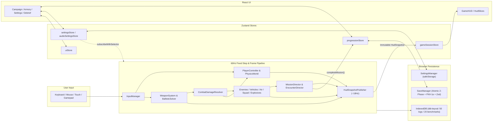
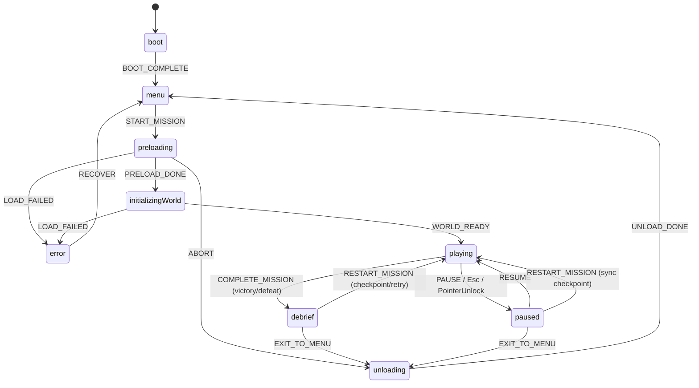

# VANGUARD: ZERO HOUR — Complete Current-State Technical & Gameplay Audit

**Audit Type:** Investigation-Only Current-State Analysis (Zero Code Modifications)  
**Target Codebase:** `VANGUARD: ZERO HOUR` (Browser-Based 3D Tactical First-Person Shooter)  
**Audit Basis:** Direct static inspection of source code, configuration, schemas, stores, shaders/render pipeline, gameplay managers, audio synthesis, persistence, and test definitions across `/src`, `/e2e`, and root configuration files.  

---

## Executive Summary

**VANGUARD: ZERO HOUR** is a 100% client-side, browser-based 3D tactical military FPS built on **React 19**, **TypeScript 7**, **Vite 8**, **Three.js 0.187**, **`postprocessing` 6.39**, **`three-mesh-bvh`**, **Zustand 5**, **XState 5**, and **Zod 4**. The codebase comprises **~85,000 non-test lines of TypeScript/TSX** across ~176 production files plus **17,605 lines of unit/integration tests** across 43 test files (**~102,605 total LOC**).

Its most distinctive engineering characteristic is that **100% of 3D geometry, PBR surface textures, sound effects (42 layered SFX), radio voices, and background music (6 stereo tracks) are procedurally synthesized in TypeScript at runtime**—there are zero external `.glb`/`.gltf` models, zero audio files, and zero external texture images in `public/` (only 5 `.webp` campaign/mode UI card images exist under `src/assets/images/`).

The game ships a complete 5-mission campaign across 4 distinct biome maps (`warzone_city`, `desert_base`, `jungle_zone`, `industrial_complex`), 9 firearms/launchers, 13 explosive/ordnance profiles (including C4, 4 air-delivered conventional bombs, and a fictional strategic fusion strike), drivable/gunnable vehicles, enemy aircraft and boss gunships, dual deployment doctrines (**Fireteam Mode** with 3 persistent AI operators vs. **Solo Operator Mode**), cross-mission consequence tracking, and local persistence (`localStorage` atomic checksummed saves + `IndexedDB` telemetry/benchmarks).

At the same time, static analysis reveals concrete technical debt and edge-case risks: heavy architectural concentration in mega-modules (`GameEngine.ts` at 3,101 LOC, `EnemyManager.ts` at 2,244 LOC, and 4 additional files >1,700 LOC), four overlapping lifecycle/pause state authorities, a subtle >60Hz input double-trigger window between `GameLoop.tick()` and `input.endFrame()`, hardcoded `1/60` delta in frame telemetry/adaptation, synchronous world rebuild on checkpoint restart, synchronous main-thread stereo music synthesis (~705k samples per track switch), and a synthetic/hardcoded WebGPU benchmark slice that always retains the WebGL2 backend.

---

## 1. Game Overview & Actual Gameplay

### 1.1 Genre, Concept & Core Experience
`VANGUARD: ZERO HOUR` is a single-player, mission-based 3D tactical first-person shooter played directly in the browser (desktop keyboard/mouse, iframe click-drag fallback, gamepad, or mobile landscape touch controls). The player leads **Vanguard Squad** (or deploys solo as a **Solo Operator**) across five scripted multi-stage military operations involving infantry firefights, armored vehicles, attack helicopters/gunships, C4 demolition, air-strike ordnance, and extraction.

### 1.2 Primary Gameplay Loop
1. **Menu & Pre-Deployment (`title` → `campaign` / `armory`)**:
   - Select one of 5 campaign missions (with sequential unlock rules unless unlocked), difficulty (`easy`, `normal`, `hard`, `extreme`), deployment doctrine (`fireteam` vs. `solo`), replay mode (`canonical`, `campaign_replay`, `clean_replay`), and optional replay modifiers (`scarce_supply`, `precision_doctrine`, `high_lethality`, `iron_operator`).
   - Optionally customize carried 3-slot mission kit (`primaryWeapon`, `secondaryWeapon`, `heavyWeapon`), purchase weapon upgrades/attachments with Requisition Points (**REQ**), configure operator cosmetics, or manage fireteam squad roster/roles in the Armory.
2. **Async Mission Load (`loading`)**:
   - 4-stage staged preload (`MissionLifecycleLoader`) builds procedural world geometry, PBR textures, collision BVH + spatial hashes, navigation worker grid, and mission entities, displaying progress to the user.
3. **Active Combat (`playing`)**:
   - Move on foot (walk, sprint, crouch, jump, step-climb, vault/mantle, climb ladders, ride cargo lifts) or board/drive/shoot from armed vehicles.
   - Complete sequential **primary objective stages** (eliminate patrols/defenders, destroy AA radars/fuel tanks/munitions caches/convoys, shoot down attack helicopters/drones/gunships, reach extraction beacon) and optional **secondary bonus objectives**.
   - Manage health, armor, reserve ammo, REQ economy, field supply stations (ammo/armor/medkit/field armory weapon swap), C4 charges, air-delivered bomb strikes, and (in Fireteam mode) squad formations, tactical orders, and operator revives.
4. **Resolution (`debrief`)**:
   - **Victory**: Final objective completed (or extraction beacon reached in M5). Awards score, mission grade (`S` / `A` / `B` / `C`), XP/rank progression, REQ payout, challenge/achievement progress, squad survival/recovery updates, and cross-mission campaign consequence ledger entries.
   - **Defeat**: Player reaches 0 HP → enters **Downed Kill-Cam** window (`2.2s` standard, or `4.8s` in Solo mode when Emergency Trauma Self-Recovery `[F]` is available). On timer expiry, enters defeat debrief with options to **Restart Checkpoint** (unless `iron_operator` modifier disabled checkpoints), **Retry Mission**, or **Return to Campaign**.

### 1.3 Campaign Missions & Objective Rules (`src/data/missions.ts`)

| Mission | Title | Map & Lighting | Primary Objective Stages | Optional / Secondary Objectives |
|---|---|---|---|---|
| **M1** | `OP. IRON DAWN` | `warzone_city` (`daylight`) | 1. Eliminate 10 enemy infantry<br>2. Destroy 2 AA Radar installations<br>3. Destroy 1 Attack Helicopter | Destroy Urban Technical (+300 score) |
| **M2** | `OP. RED DUST` | `desert_base` (`sunset`) | 1. Destroy 3 Convoy Vehicles *(objective marker dynamically tracks nearest live convoy vehicle)*<br>2. Destroy 3 Fuel Depot Tanks<br>3. Eliminate 8 Base Defenders | — |
| **M3** | `OP. NIGHTFALL` | `warzone_city` (`night`) | 1. Destroy 4 Attack Drones<br>2. Destroy 3 Helicopters / Gunship<br>3. Eliminate 6 Ground Spotters | Blackout 2 Searchlight Towers (+150 each, +350 all) |
| **M4** | `OP. VIPER CANOPY` | `jungle_zone` (`misty_dawn`) | 1. Eliminate 10 Jungle Patrols<br>2. Sabotage/Demolish 2 Weapons Caches *(`charge_or_c4_only` policy with anti-softlock `bypassed` fallback)*<br>3. Destroy 2 Recon Aircraft | — |
| **M5** | `OP. BLACKOUT` | `industrial_complex` (`storm_dusk`) | 1. Destroy 3 Munitions Containers<br>2. Eliminate 12 Elite/Heavy Siege Troops<br>3. Destroy 1 Command Gunship (multi-phase boss)<br>4. Reach North Extraction Beacon (`z: -72`) | Destroy Foundry Armor (+350 score) |

### 1.4 Implemented Gameplay Mechanics

- **Arsenal (`src/data/weapons.ts` — 9 weapons in `WEAPON_CATALOG`)**:
  1. `assault_rifle` (M41-V Carbine) — hitscan, automatic
  2. `smg` (VX-9 Vector) — hitscan, high ROF automatic
  3. `sniper_rifle` (M98-V Longshot) — hitscan, scope zoom, high headshot multiplier
  4. `shotgun` (M870-V Breacher) — multi-pellet hitscan burst
  5. `lmg` (MK48-V Saw) — hitscan, high-capacity suppression
  6. `pistol` (P22-V Sidearm) — hitscan, semi-auto fallback
  7. `rocket_launcher` (AT-4X) — unguided anti-armor rocket projectile
  8. `guided_missile` (FIM-92X Stinger) — lock-on anti-air tracking missile (`acquiring` → `locked` state)
  9. `grenade_launcher` (M32-V) — ballistic 40mm parabolic explosive shell
  - *Mission Carry Limit*: Missions deploy with **3 carried weapon slots** (`primaryWeapon`, `secondaryWeapon`, `heavyWeapon`) from `progressionStore.activeMissionLoadout`. Players can swap carried weapons mid-mission at active `ammo_crate` stations within `5.2m` for `60 REQ` (or reserve-ammo tradeoff).
- **Explosives & Ordnance (`src/schemas/explosive.schema.ts` — 13 profiles in `EXPLOSIVE_CATALOG`)**:
  - Hand grenades (`[G]`), 40mm GL shells, AT-4X rockets, FIM-92X guided missiles, enemy rockets/grenades.
  - **M112-V C4 Charges**: `[C]` primes placement preview (wireframe placement indicator visible only while aiming/priming C4), left-click places (max 4 active), `[X]` detonates all planted charges.
  - **Air-Delivered Conventional Bombs (`[V]` call / `[B]` cycle)**: 4 ordnance types costing `150–320 REQ` (including `cluster_munition_bomb`, which splits mid-descent into submunitions).
  - **Fictional `TRIDENT-X` Strategic Fusion Strike (`[N]` request + `[Enter]` confirm)**: Costs `1500 REQ`, `5s` fuse, `95m` blast radius, leaves a `60s` persistent `75m` fallout hazard zone.
- **Deployment Modes**:
  - **Fireteam Mode (`FriendlySquadManager.ts`)**: Up to 3 AI operators selected from a persistent 5-operator roster with distinct roles (`assault`, `medic`, `support`, `recon`, `heavy`), formations (`WEDGE`, etc.), tactical commands (`REGROUP`, `MOVE`, `ATTACK_TARGET`, `FLANK`, `BOARD_VEHICLE` via `[F1]–[F4]` or command wheel), medic and player revives (`18s` bleedout on Normal), optional Ironman permadeath/MIA, HQ recovery across missions, and synthesized operator radio voice callouts.
  - **Solo Operator Mode (`SoloEncounterDirector.ts`)**: Completely skips friendly squad ticks and squad nav solves; constrains concurrent enemy attacker leases, spawns bonus solo supply stations, and grants a 1-charge **Emergency Trauma Self-Recovery** (`[F]` during extended `4.8s` downed window).
- **Sustainment & Anti-Softlock (`SustainmentEconomyManager.ts`)**:
  - Physical world supply stations (`ammo_crate`, `armor_pack`, `medkit_station`) with interact prompts (`[E]`), cooldowns, REQ costs, and an automatic **Emergency Ordnance Air-Drop** fallback if the player exhausts anti-armor/demolition resources during an ordnance-gated objective (e.g., M4 caches or armored targets).
- **Progression, Upgrades & Replay Consequences (`progressionStore.ts`)**:
  - XP & military ranks, Requisition Points (default `500 REQ`), 5-tier weapon upgrades, 5 attachment slots (`optic`, `muzzle`, `barrel`, `underbarrel`, `magazine`), weapon mastery kill counters, daily/career challenges, achievements, saved weapon builds & loadout presets, operator cosmetics (camo/helmet/patch), and `CampaignEventLedger` cross-mission consequence modifiers (bonus supply charges, starting C4, adjusted reinforcement pacing) with `creditedOperationRunIds` idempotency protection.

### 1.5 Implemented vs. Simulated, Hardcoded, Placeholder, or Unused Seam Features

| Category | Feature / Symbol | Actual Implementation Status | Evidence |
|---|---|---|---|
| **Fully Implemented** | 5-mission campaign, 4 procedural maps, 9 weapons, 13 explosives, vehicles, air/boss combat, Fireteam & Solo modes, 60Hz FPS physics, Web Worker 3D A*, procedural PBR + Web Audio SFX/music, atomic local persistence | Active in production runtime paths | `src/engine/`, `src/gameplay/`, `src/world/`, `src/audio/`, `src/storage/` |
| **Synthetic / Hardcoded** | WebGPU 3-way vertical slice benchmark (`evaluateRenderingVerticalSlice`) | **Hardcoded numbers (`14.2ms`, `22.8ms`, `26.5ms`)** and synthetic ratios (`0.78x`, `0.74x`, `0.88x`). Always selects `webgl_renderer_baseline` and returns `activeRuntimeBackend: 'webgl2'`, even when `requestedBackend === 'webgpu'`. | `src/engine/RenderingBenchmarkSlice.ts:302–382` |
| **Unused Seam** | External audio URL loading (`loadExternalSoundBuffer`, `sourceType === 'url'` in `MusicPlayerController`) | Implemented method/branch exists, but **0 callers** in `src/`; `MUSIC_TRACK_CATALOG` uses `sourceType: 'procedural'` exclusively. | `src/audio/AudioManager.ts`, `src/audio/MusicPlayerController.ts`, `src/audio/MusicCatalog.ts` |
| **Unused Seam** | External texture URL fallback (`AssetManager.loadTextureWithFallback`) | External URL loading seam exists, but all 4 maps use procedural `DataTexture` PBR bundles exclusively. | `src/core/AssetManager.ts` |
| **Copy / Metadata Drift** | `index.html` advertises `"10 weapons"`; `metadata.json` declares `MAJOR_CAPABILITY_SERVER_SIDE_GEMINI_API`; `package.json` name is `"react-example"` | `WEAPON_CATALOG` contains **9** weapons (plus separate explosives/ordnance). Zero Gemini API calls or server routes exist anywhere in the repository. | `index.html`, `metadata.json`, `package.json`, `src/data/weapons.ts` |
| **Local-Only Simulation** | `HardwareQaModal` diagnostics / hardware readiness telemetry | Measures local browser frame times and exports local JSON reports; no remote telemetry endpoint exists. | `src/ui/components/HardwareQaModal.tsx`, `src/engine/GameEngine.ts:2765` |

### 1.6 Boot-to-Exit Player Journey
1. **HTML & React Mount**: `index.html` loads Google Fonts (`Chakra Petch`, `Inter`, `JetBrains Mono`) and mounts `src/main.tsx` → `src/App.tsx`.
2. **Engine Initialization**: `App.tsx` creates the canvas container, instantiates `GameEngine`, hydrates persisted settings (`SettingsManager`) and progression (`SaveManager`), binds global keyboard/visibility/resize listeners, and lands on `screen === 'title'`.
3. **Mobile Portrait Gate**: `useViewportMode.ts` detects coarse-pointer portrait viewports and renders a full-screen rotate-to-landscape gate before gameplay.
4. **Campaign / Armory**: Player configures mission/loadout/settings; opening the 3D Armory preview mounts `ArmoryWeaponStage3D` (a secondary WebGL canvas skipped automatically on software GL).
5. **Mission Launch**: `GameEngine.startMission()` aborts any prior load via `AbortController`, resets `gameSessionStore`, transitions `uiStore` to `'loading'`, runs `MissionLifecycleLoader` across 4 yielded stages, starts `GameLoop` and Web Audio ambience/music, transitions `EngineLifecycle` and `uiStore` to `'playing'`, and requests Pointer Lock (skipped on touch or when Combat Debug overlay is open).
6. **Pause / Resume / Restart**: Pressing `Esc` (or losing Pointer Lock when not suppressed) transitions to `'paused'`, suspending audio and pausing `GameLoop`. Player can resume, adjust settings live, restart from checkpoint (synchronous rebuild), or abort to menu.
7. **Debrief & Exit**: On victory or defeat bleedout, `completeMission()` calculates grades/rewards, commits progression atomically via `SaveManager`, stops mission loops, exits pointer lock, and switches `uiStore` to `'debrief'`. Returning to menu calls `unloadToMenu()`, disposing the `mission:<id>` `ResourceManager` scope and Web Worker.

---

## 2. Complete Game Architecture

### 2.1 Technology Stack & Runtime
- **Runtime**: 100% Client-Side Browser SPA (ES Modules, WebGL2, Web Audio API, Dedicated Module Web Worker, `localStorage`, `IndexedDB`). **No backend server, no Express runtime, no WebSockets.**
- **Core Frameworks & Libraries (`package.json`)**:
  - **UI & Build**: `react` `19.0.1`, `react-dom` `19.0.1`, `typescript` `7.0.2`, `vite` `8.3.0`, `tailwindcss` `4.3.3` (`@tailwindcss/vite`), `@radix-ui/*` primitives, `lucide-react`.
  - **3D Engine & Spatial Math**: `three` `0.187.0`, `postprocessing` `6.39.6`, `three-mesh-bvh` `0.9.18`.
  - **State, Validation & Storage**: `zustand` `5.1.0` (vanilla stores + `subscribeWithSelector`), `xstate` `5.33.4`, `zod` `4.6.7`, `idb-keyval` `6.3.0`.
  - **Testing**: `vitest` `5.1.0`, `jsdom`, `@testing-library/react`, `@playwright/test` `1.65.1`.

### 2.2 Codebase Layout & Size Distribution

| Directory | Files | Non-Test / Test LOC | Primary Responsibility |
|---|---:|---:|---|
| `src/gameplay/` | 46 | 28,640 | Player FPS controller, weapons, ballistics, damage, AI enemies, friendly squad, vehicles, air combat, explosives, mission director, sustainment, telemetry |
| `src/ui/` | 40 | 17,926 | Screens (Title, Campaign, Armory, Loading, Pause, Debrief), HUD slices, touch controls, settings panel, F3/F4 debug overlays, Armory 3D stage |
| `src/tests/` | 43 | 17,605 | Vitest unit & integration test suites (physics, AI, weapons, progression, persistence, HUD, maps, audio, workers) |
| `src/engine/` | 22 | 11,998 | `GameEngine` orchestrator, `GameLoop`, XState `EngineLifecycle`, WebGL2 `EngineRenderer`, CSM shadows, `PhysicsWorld`, `InputManager`, `HudSnapshotPublisher`, GPU/adaptive governors |
| `src/world/` | 18 | 7,576 | 4 procedural maps, `VerticalStructuresBuilder` (standardized stairs/rooftops/bunkers), `WorldPropsAndLandmarks`, `MissionEnvironmentEnhancer`, chunk visibility |
| `src/data/` | 8 | 2,913 | Static catalogs (`weapons.ts`, `missions.ts`, upgrades, attachments, cosmetics, challenges, squad roster) |
| `src/schemas/` | 12 | 2,780 | Zod validation schemas (`save.schema.ts`, `explosive.schema.ts`, settings, mission, squad, telemetry) |
| `src/audio/` | 4 | 2,750 | Procedural Web Audio SFX synthesizer (42 voices), radio voice synth, 6-track procedural stereo music player & catalog |
| `src/workers/` | 3 | 2,233 | `WorkerBridge` main-thread RPC client, `navigation.worker.ts`, `navigationCore.ts` (3D multi-surface hierarchical A*) |
| `src/stores/` | 6 | 2,016 | 6 Zustand vanilla stores bridging engine and React UI |
| `src/effects/` | 3 | 1,948 | Pooled particle VFX, battlefield explosions/smoke, surface impact decals |
| `src/physics/` | 4 | 1,297 | `CollisionWorld`, `SpatialHash` (8m broad-phase), `OrientedSlope`, BVH raycast helpers |
| `src/core/` | 3 | 1,103 | Scoped `ResourceManager`, procedural PBR `AssetManager` |
| `src/assets/` | 1 TS + 5 `.webp` | 794 | Procedural SVG/image metadata & 5 campaign/mode `.webp` cards |
| `src/storage/` | 3 | 369 | Atomic checksummed `SaveManager`, `SettingsManager`, `safeStorage` |
| `src/navigation/` | 1 | 158 | Shared navigation types/contracts |
| `src/config/` | 1 | 52 | Global runtime constants |
| `e2e/` | 1 | — | Playwright E2E spec (`responsive-and-gameplay.spec.ts`) |
| **Total** | **~220** | **~102,605** | **~85,000 production LOC + 17,605 test LOC** |

#### Top 15 Largest Production Files (~23,000 LOC = 27% of Non-Test Code)
1. `src/engine/GameEngine.ts` — **3,101 LOC**
2. `src/gameplay/EnemyManager.ts` — **2,244 LOC**
3. `src/ui/hud/HudSlices.tsx` — **1,953 LOC**
4. `src/world/VerticalStructuresBuilder.ts` — **1,892 LOC**
5. `src/ui/hud/MobileTouchControls.tsx` — **1,815 LOC**
6. `src/ui/components/SettingsPanel.tsx` — **1,771 LOC**
7. `src/gameplay/WeaponSystem.ts` — **1,519 LOC**
8. `src/gameplay/PlayerController.ts` — **1,473 LOC**
9. `src/gameplay/squad/FriendlySquadManager.ts` — **1,470 LOC**
10. `src/gameplay/VehicleManager.ts` — **1,435 LOC**
11. `src/gameplay/telemetry/CombatTelemetryRecorder.ts` — **1,380 LOC**
12. `src/ui/debug/CombatDebugTabs.tsx` — **1,374 LOC**
13. `src/world/WorldPropsAndLandmarks.ts` — **1,335 LOC**
14. `src/audio/AudioManager.ts` — **1,315 LOC**
15. `src/workers/navigationCore.ts` — **1,256 LOC**

### 2.3 System Architecture Diagram

```mermaid
graph TB
    subgraph Browser["Browser Runtime & DOM"]
        DOM["DOM / Canvas / PointerLock / Touch / Gamepad"]
        LS["localStorage (Atomic Save + Settings)"]
        IDB["IndexedDB (idb-keyval: Logs & Benchmarks)"]
        WA["Web Audio API (3D Panner + Convolution Reverb)"]
        WW["Dedicated Module Web Worker (navigation.worker.ts)"]
    end

    subgraph ReactUI["React 19 Presentation Layer (src/ui)"]
        App["App.tsx (Bootstrap & Screen Router)"]
        Screens["Title / Campaign / Armory / Pause / Debrief"]
        Armory3D["ArmoryWeaponStage3D (Secondary WebGL Context)"]
        HUD["GameHUD + HudSlices + MobileTouchControls"]
        DebugUI["F3 Perf Overlay + F4 CombatDebugTabs"]
    end

    subgraph Stores["Zustand 5 Vanilla Stores (src/stores)"]
        UIStore["uiStore (screen, pause, lock, overlays)"]
        SessionStore["gameSessionStore (18Hz HudSnapshot, feed, downed)"]
        ProgStore["progressionStore (XP, REQ, unlocks, ledger, squad)"]
        SettingsStore["settingsStore + audioSettingsStore"]
        MissionSel["missionSelectionStore"]
    end

    subgraph EngineCore["Engine Orchestration (src/engine & src/core)"]
        GE["GameEngine (3,101 LOC Facade & Mediator)"]
        Lifecycle["EngineLifecycle (XState 5 FSM)"]
        Loop["GameLoop (rAF + 60Hz Fixed Step + 18Hz UI)"]
        Input["InputManager (KB/Mouse/Drag/Touch/Gamepad)"]
        Renderer["EngineRenderer (WebGL2 + EffectComposer + Dual Scene)"]
        Phys["PhysicsWorld + CollisionWorld (SpatialHash + BVH)"]
        ResMgr["ResourceManager (Scoped GPU/DOM Disposal)"]
        AssetMgr["AssetManager (Procedural PBR DataTextures)"]
        Adapt["GraphicsAdaptiveCoordinator (QualityDirector + Governor)"]
        HudPub["HudSnapshotPublisher"]
    end

    subgraph Gameplay["Gameplay Managers (src/gameplay & src/world)"]
        Player["PlayerController"]
        Weapons["WeaponSystem + BallisticSolver"]
        Damage["CombatDamageResolver + EngagementCoordinator"]
        Enemies["EnemyManager"]
        Squad["FriendlySquadManager"]
        Vehicles["VehicleManager"]
        Air["AirCombatManager"]
        Explosives["ExplosiveManager"]
        Director["MissionDirector + Encounter/Solo Directors"]
        Sustain["SustainmentEconomyManager"]
        World["Procedural Map Builders + VerticalStructuresBuilder"]
    end

    subgraph Audio["Procedural Audio (src/audio)"]
        AudioMgr["AudioManager (42 Synth SFX + Radio)"]
        Music["MusicPlayerController + MusicCatalog (6 Synth Tracks)"]
    end

    App --> GE
    App --> Screens
    App --> HUD
    App --> DebugUI
    Screens --> Armory3D
    HUD <--> SessionStore
    Screens <--> ProgStore
    Screens <--> MissionSel
    Screens <--> SettingsStore
    App <--> UIStore

    GE --> Lifecycle
    GE --> Loop
    GE --> Input
    GE --> Renderer
    GE --> Phys
    GE --> ResMgr
    GE --> AssetMgr
    GE --> Adapt
    GE --> HudPub
    GE --> AudioMgr
    AudioMgr --> Music
    AudioMgr --> WA

    GE --> Player
    GE --> Weapons
    GE --> Damage
    GE --> Enemies
    GE --> Squad
    GE --> Vehicles
    GE --> Air
    GE --> Explosives
    GE --> Director
    GE --> Sustain
    GE --> World

    Input <--> DOM
    Renderer --> DOM
    HudPub --> SessionStore
    GE <--> UIStore
    GE <--> ProgStore
    GE <--> SettingsStore
    ProgStore <--> LS
    SettingsStore <--> LS
    GE <--> IDB
    GE <--> WW
    Enemies -.-> WW
```



### 2.4 Architectural Style, Module Boundaries & Communication Patterns
- **Entity Model**: **Procedural OOP Manager Architecture** (NOT a pure ECS). Each entity category (`EnemyManager`, `VehicleManager`, `AirCombatManager`, `FriendlySquadManager`, `ExplosiveManager`, `ProjectileManager`) owns typed plain-object/struct arrays paired with Three.js `THREE.Group` rigs, pre-allocated scratch vectors/sets, and object pools.
- **Mediator Hub**: `GameEngine.ts` acts as the central mediator wiring ~35 subsystems via constructor injection, direct method calls, and callback hooks. Cross-subsystem interaction routes either through `GameEngine` or through narrow collaborator interfaces (`CombatDamageResolver`, `CombatEngagementCoordinator`, `CollisionWorld`).
- **Engine ↔ UI Boundary**: Strictly **one-way reactive publishing** for HUD telemetry (`HudSnapshotPublisher` pushes an immutable snapshot object to `gameSessionStore` at ~18Hz) and **imperative commands** from React back to `GameEngine` (`startMission`, `pause`, `resume`, `restartCheckpoint`, `abortToMenu`, `applyLiveSettings`). Settings changes flow reactively via `settingsStore.subscribe` / `audioSettingsStore.subscribe` listeners registered in `GameEngine`.
- **Resource Lifecycle**: `ResourceManager` tracks geometries, materials, textures, audio nodes, and DOM event listeners under named scopes (`'global'`, `'mission:<id>'`). Unloading a mission disposes the entire `'mission:<id>'` scope in one call.
- **Off-Thread Navigation**: `WorkerBridge` wraps `navigation.worker.ts` with typed request/response IDs, transferable `ArrayBuffer` serialization (`Float32Array`, `Int32Array`, `Uint8Array`), job-version cancellation, and a 250ms timeout fallback.

---

## 3. Game Data, State & Data Flow

### 3.1 Authoritative State Ownership Matrix

| Domain | Authoritative Owner | Storage Type | Mutated By | Consumed By |
|---|---|---|---|---|
| **App Screen & Overlays** | `uiStore` (`src/stores/uiStore.ts`) | In-memory Zustand | `App.tsx`, `GameEngine`, HUD/Menu actions | All React screens, `GameEngine` guards |
| **Engine Lifecycle Phase** | `EngineLifecycle` (`src/engine/EngineLifecycle.ts`) | In-memory XState 5 actor | `GameEngine` transitions | `GameEngine`, diagnostics |
| **Loop Pause & Timing** | `GameLoop` (`src/engine/GameLoop.ts`) | Class fields | `GameEngine` (`pause`/`resume`/`debugSimPaused`) | `GameLoop.tick` |
| **Live Combat Telemetry & HUD** | `gameSessionStore` (`src/stores/gameSessionStore.ts`) | In-memory Zustand (ephemeral per mission) | `HudSnapshotPublisher`, `GameEngine` | `GameHUD`, `HudSlices`, `DebriefScreen` |
| **Player Physics, HP, Armor, Stance** | `PlayerController` (`src/gameplay/PlayerController.ts`) | Mutable engine class | `PlayerController.update`, `CombatDamageResolver`, `SustainmentEconomyManager` | `GameEngine`, `WeaponSystem`, `EnemyManager`, `HudSnapshotPublisher` |
| **Carried Weapons, Ammo, ADS, Lock-On** | `WeaponSystem` (`src/gameplay/WeaponSystem.ts`) | Mutable engine class | `WeaponSystem.update`, `SustainmentEconomyManager`, `GameEngine` | `HudSnapshotPublisher`, `CombatDamageResolver`, `AudioManager` |
| **World Geometry & Collision BVH** | `WorldData` + `CollisionWorld` + `PhysicsWorld` | Mutable per-mission structs | `MissionLifecycleLoader` / map builders, `ExplosiveManager` (destructibles) | `PlayerController`, `BallisticSolver`, `EnemyManager`, `WorkerBridge` |
| **Enemies, Vehicles, Aircraft, Squad, Explosives** | Respective `*Manager` classes | Mutable pooled arrays | Manager `update()` ticks, `CombatDamageResolver`, `ExplosiveManager` | `GameEngine`, `MissionDirector`, `HudSnapshotPublisher` |
| **Mission Objectives & Stage State** | `MissionDirector` (`src/gameplay/MissionDirector.ts`) | Mutable engine class | `MissionDirector.update`, kill/destruction notifications | `GameEngine`, `EncounterDirector`, `HudSnapshotPublisher` |
| **Persistent Profile, REQ, Unlocks, Squad Roster, Campaign Ledger** | `progressionStore` (`src/stores/progressionStore.ts`) | Zustand + `localStorage` (`SaveManager`) | `GameEngine.completeMission`, Armory/Campaign UI | Campaign, Armory, Debrief, `GameEngine` mission init |
| **Display, Graphics, Input, Audio Settings** | `settingsStore` + `audioSettingsStore` | Zustand + `localStorage` (`SettingsManager`) | `SettingsPanel`, `GraphicsAdaptiveCoordinator` | `GameEngine` reactive subscribers, `EngineRenderer`, `AudioManager`, `InputManager` |
| **Mission Selection & Modifiers** | `missionSelectionStore` | In-memory Zustand | `CampaignScreen` | `GameEngine.startMission`, `restartCheckpoint` |
| **Combat Logs & Benchmarks** | `SaveManager` (`idb-keyval`) | Browser `IndexedDB` | `GameEngine`, `HardwareQaModal` | `CombatDebugTabs`, `DiagnosticExporter` |
| **Static Game Definitions** | `src/data/*` & `src/schemas/explosive.schema.ts` | Readonly TS constants | Immutable at runtime | Weapons, missions, upgrades, explosives, music catalog |

### 3.2 Data-Flow Diagram



### 3.3 Concrete Traced Data Flows

#### Trace 1: Player Shot → Hit Registration → Enemy Elimination → Objective & HUD Update
1. `InputManager` captures mouse/touch fire press; `GameEngine.onFixedStep` calls `this.weapons.update(dt, this.input, ...)`.
2. `WeaponSystem` checks fire cooldown, ammo in magazine, reload state, and recoil; emits a shot event (monotonic `shotId`) and spawns muzzle flash VFX + acoustic gunshot intel event (`encounterDirector.intelBoard`).
3. For hitscan weapons, `BallisticSolver` casts a BVH-accelerated ray against `CollisionWorld` geometry and active target hitboxes collected by `CombatDamageResolver.collectFrameTargets()`.
4. `CombatDamageResolver` computes range falloff, headshot/weakpoint multiplier, armor absorption, and applies damage to `EnemyManager.damageUnit()` (deduplicated via `shotId`).
5. On enemy death: `EnemyManager` decrements active count, triggers death animation/ragdoll-collapse & score event; `MissionDirector` records the elimination against the active objective's target count and advances stage if threshold met; `gameSessionStore` receives a hit-marker/kill-feed event; `AudioManager` plays hit/kill confirmation SFX.
6. On the next ~18Hz tick (`GameLoop.ts:122–126`), `HudSnapshotPublisher` reads `player`, `weapons`, `missionDirector`, and entity arrays, diffs minimap blips and 3D-projected objective markers, and writes a fresh `HudSnapshot` to `gameSessionStore`. React `GameHUD` / `HudSlices` selectively re-renders subscribed slices.

#### Trace 2: Mission Completion → Progression Commit → Atomic Persistence
1. `MissionDirector.update()` returns `{ finished: true, victory: true }` inside `GameEngine.onFixedStep` (`GameEngine.ts:2523–2526`), calling `this.completeMission(true)`.
2. `GameEngine.completeMission()` halts combat loops, computes mission grade (`S`/`A`/`B`/`C`), REQ/XP payouts, weapon mastery deltas, challenge progress, fireteam survival/recovery records, and cross-mission `CampaignEventLedger` consequences.
3. Calls `progressionStore.getState().recordMissionResult(...)`, which checks `creditedOperationRunIds` to prevent duplicate credit on replay/double-invoke, updates in-memory profile state, and invokes `SaveManager.saveProgression()`.
4. `SaveManager` (`src/storage/SaveManager.ts`) validates the payload against `ProgressionSaveSchema` (Zod v4, version 2, `schemaRevision: 4`), wraps it in an FNV-1a checksum envelope, writes to `STAGING_KEY`, copies prior valid data to `BACKUP_KEY`, then commits `SAVE_KEY` in `localStorage` via `safeStorage`.
5. `gameSessionStore` stores the debrief payload, `EngineLifecycle` transitions to `debrief`, and `uiStore.setScreen('debrief')` renders `DebriefScreen`.

### 3.4 Persistence, Restart, Refresh & Conflicting State Authorities
- **Persistence Scope**:
  - `localStorage`: Player profile/progression (`SaveManager` with atomic staging/backup + FNV-1a checksum + automatic schema migration/backfill from corrupt or partial fields) and user settings (`SettingsManager` key `vanguard_zero_hour_settings_v2`). Both wrap `window.localStorage` in `safeStorage.ts`, which silently falls back to an ephemeral in-memory `Map` if `SecurityError` or `QuotaExceededError` occurs.
  - `IndexedDB` (`idb-keyval`): Stores up to **50** combat telemetry logs and **20** hardware benchmark snapshots.
  - **Cookies / `sessionStorage` / Backend**: None used.
- **Refresh Behavior**: Mid-mission runtime state (player position, live enemy HP, active projectiles, partial objective stage progress) is **NOT persisted**. Refreshing the browser restarts at the Title screen with last committed campaign progression and settings intact.
- **Restart Behavior**: `restartCheckpoint()` restores from an in-memory `activeCheckpointSnapshot` captured at stage transitions (disabled under `iron_operator` modifier), incrementing `checkpointDeathsCount`, resetting `gameSessionStore`, and rebuilding the mission world synchronously.
- **Confirmed Overlapping / Competing State Authorities**:
  1. **Lifecycle & Pause State**: Simultaneously tracked across **4 places**: `EngineLifecycle` (XState actor), `uiStore.screen`, `uiStore.debugSimPaused`, and `GameLoop.paused`. `GameEngine` manually synchronizes all four on every `pause()`, `resume()`, `restartCheckpoint()`, and debug-step call.
  2. **Adaptive Quality Authority**: Both `RenderingQualityDirector` (6-step adaptive director) and `PerformanceGovernor` (4-tier profile governor) are instantiated and coordinated inside `GraphicsAdaptiveCoordinator`, with some consumers reading `this.governor.getProfile()` directly (`GameEngine.ts:2575, 2819, 2822`).

---

## 4. Gameplay Mechanics & Game Conditions

### 4.1 Core Mechanics Implementation Details
- **Movement & FPS Physics (`PlayerController.ts`, `PhysicsWorld.ts`)**:
  - Custom capsule character controller stepped at fixed `60Hz` (`1/60s`).
  - Supports sprint, crouch (with upward ceiling clearance raycast before standing), jump, verified step-climbing, vault/mantle probing over low obstacles, vertical ladder climbing, cargo lift platform riding, and vehicle boarding/exiting.
  - **Collision**: `CollisionWorld` maintains an 8m `SpatialHash` for static/dynamic AABBs, an 8m spatial cell index of `OrientedSlope` ramps/stairs (standardized across all 4 maps via `VerticalStructuresBuilder`), `three-mesh-bvh` patched onto `THREE.BufferGeometry`/`THREE.Mesh.prototype.raycast` for triangle-accurate ballistic raycasts, vehicle OBB impulse deflection, and hard world bounds (`±106m`).
- **Combat, Ballistics & Damage (`WeaponSystem.ts`, `BallisticSolver.ts`, `CombatDamageResolver.ts`)**:
  - `BallisticSolver` performs 5-point anatomical visibility & spread raycasts for AI line-of-sight and ballistic impact resolution.
  - `PlayerController` models separate Health + Armor pools, difficulty-scaled regeneration delay/rate, spawn grace invulnerability, and damage deduplication (`lastShotIdApplied` + 64-entry ring set `appliedExplosionIds`).
- **Enemy AI & Fairness Leases (`EnemyManager.ts`, `CombatEngagementCoordinator.ts`)**:
  - Archetypes include standard infantry, snipers, heavy armor, rocket troopers, spotters, and elite assault troops.
  - Finite-state AI behaviors (patrol, alert, cover-seeking using map `coverNodes`, flanking, suppression, firing) paired with off-thread 3D A* path queries (`WorkerBridge`) and acoustic/visual intel (`EncounterDirector.intelBoard`).
  - `CombatEngagementCoordinator` enforces difficulty- and mode-scaled **attacker leases** so enemies do not simultaneously focus-fire the player unfairly on a single frame, with climax-encounter overrides during final objectives or boss fights (`GameEngine.ts:2531–2541`).
- **Vehicles & Air Combat (`VehicleManager.ts`, `AirCombatManager.ts`)**:
  - Ground vehicles support player driving/gunning, camera mode cycling, friendly squad boarding seats (`getFriendlySeatViews`), hostile patrol/convoy paths, and dynamic nearest-convoy objective diamond synchronization in M2.
  - Aircraft include drones (including dynamically spawned drones via `onSpawnDynamicDrone`), recon aircraft, attack helicopters, and multi-phase Command Gunship bosses with lock-on telemetry for `FIM-92X`.
- **Explosives & Chain Reactions (`ExplosiveManager.ts`)**:
  - Pooled `_damagedIdSetPool` prevents a single blast from double-damaging multi-collider entities; supports blast falloff, radial impulse, destructible prop removal (which flags dirty collision regions flushed to `WorkerBridge`), cluster bomb altitude splitting, and timed fusion fallout damage zones.
- **Scoring, Grading & Economy**:
  - Kills, headshots, objective completions, secondary bonuses, and survival time feed mission score and rank grading (`S`/`A`/`B`/`C`; playtest telemetry also tracks `F`). REQ is earned via combat/objectives and spent on supply stations, field weapon swaps (60 REQ), bomb strikes (150–320 REQ), strategic fusion strike (1500 REQ), and Armory upgrades.

### 4.2 Engine & UI Lifecycle State Machine



### 4.3 Edge-Case & Condition Handling Matrix

| Condition / Edge Case | Status | Observed Code Behavior & Citation |
|---|---|---|
| **Player death / lethal damage** | **Handled** | `PlayerController` transitions to downed state; `GameEngine.onFixedStep` (`2495–2507`) runs kill-cam countdown (`2.2s` or `4.8s` in Solo with Trauma Revive `[F]`). Reaching `0` clears downed UI and calls `completeMission(false)`. |
| **Enemy death & double-kill credit** | **Handled** | `EnemyManager.damageUnit()` guards `if (!unit.alive) return false`; `MissionDirector` tracks `destroyedTargetIds` set to prevent duplicate objective increments. |
| **Simultaneous explosion / multi-collider hit** | **Handled** | `ExplosiveManager` tracks per-blast damaged entity IDs via pooled `_damagedIdSetPool`; `PlayerController` deduplicates via 64-ID ring set `appliedExplosionIds`. |
| **Simultaneous firearm shot IDs** | **Partially Handled** | `PlayerController` checks `lastShotIdApplied` (single scalar, not a set). Works because `nextShotId()` is strictly monotonic, but would not deduplicate out-of-order interleaved shot IDs. |
| **Multiple overlapping HUD interact prompts** | **Handled** | Contextual `[E]` priority chain in `GameEngine.onSampleInput` (sustainment → sabotage → cargo lift → ladder → vehicle) paired with single prioritized bottom-center prompt slot in `HudSnapshotPublisher` / `GameHUD`. |
| **Rapid edge-triggered inputs on >60Hz monitors** | **Partially Handled (Bug Risk)** | `GameLoop.tick` (`103–114`) calls `sampleInput()` on every `rAF`, whereas `input.endFrame()` is called at the end of `onFixedStep` (`GameEngine.ts:2555`). When `rawDt < 1/60` and `substeps === 0`, `justPressed` actions are not cleared before the next `rAF`, allowing consecutive-frame double triggers. |
| **Empty ammo / ordnance softlock on demolition stages** | **Handled** | `SustainmentEconomyManager` monitors ordnance depletion on demolition objectives and triggers an automatic emergency ordnance air-drop; M4 caches also include a `bypassed` anti-softlock policy. |
| **Rapid mission start / abort during async load** | **Handled** | `GameEngine` uses `activeAbortController?.abort()` (`GameEngine.ts:1359`) and scope tokens inside `MissionLifecycleLoader` to discard stale async load stages. |
| **Mid-game checkpoint restart** | **Handled (Blocking)** | `restartCheckpoint()` (`1344–1396`) cleanly disposes worker, world, audio loops, and inputs, then rebuilds world state and resets session. However, executes **synchronously in one frame** without loading screen or yielding. |
| **Corrupted / partial / legacy `localStorage` save** | **Handled** | `SaveManager` verifies FNV-1a checksum, falls back to `BACKUP_KEY` or `STAGING_KEY`, validates via Zod `ProgressionSaveSchema`, and runs deterministic field backfill or clean reset without crashing. |
| **Blocked `localStorage` (private mode / sandboxed iframe)** | **Partially Handled** | `safeStorage.ts` catches `SecurityError`/`QuotaExceededError` and falls back to an in-memory `Map` so gameplay never crashes, but progress is lost on refresh without a persistent user warning banner. |
| **Web Worker crash or A* stall** | **Handled** | `WorkerBridge` enforces a `250ms` per-request timeout returning `null` (falling back to direct steering), caps queue at `64` pending jobs, and attempts up to `2` automatic worker restarts on crash. |
| **Pointer Lock rejected / unavailable (iframe or touch)** | **Handled** | `InputManager` provides click-and-drag look fallback when Pointer Lock is unavailable; `GameEngine.requestPointerLock()` (`1408–1420`) skips Pointer Lock on coarse-pointer touch devices and when Combat Debug panel is open. |
| **Tab hidden / browser backgrounded / `pagehide`** | **Handled** | Visibility change pauses active gameplay / suspends audio; `GameLoop.ts:98` clamps `rawDt` to `0.05s` and `maxSubsteps = 4` (resetting accumulator on spiral-of-death saturation at line 112–114). |
| **Portrait mobile orientation** | **Handled** | `useViewportMode.ts` detects coarse-pointer portrait aspect and displays a rotate-to-landscape blocker. |
| **WebGL context loss** | **Handled (Main)** | `EngineRenderer` registers `webglcontextlost` / `webglcontextrestored` handlers. Secondary `ArmoryWeaponStage3D` skips WebGL entirely on software GL and disposes cleanly on unmount. |
| **Pause / Resume while Combat Debug paused** | **Partially Handled** | `debugSimPaused` pauses `GameLoop` while keeping `uiStore.screen === 'playing'`. Because `GameLoop.ts:129` still calls `render()` and `onFrameMeasured()`, the paused 3D scene continues rendering and feeding telemetry/adaptive quality while simulation is frozen. |

---

## 5. Runtime, Rendering & Browser Engineering

### 5.1 Game Loop & Timing (`src/engine/GameLoop.ts`)
- **Fixed Physics Timestep**: `fixedDt = 1 / 60` (`16.667ms`), `maxRawDt = 0.05s`, `maxSubsteps = 4` (if `substeps === 4`, remaining `accumulator` is zeroed to prevent spiral-of-death catch-up).
- **FPS Cap**: Optional `fpsCap` (`0 | 30 | 60 | 120`) enforced via `minIntervalMs = 1000 / fpsCap - 1.2`.
- **Software GL Pacing**: When `GpuCapabilityDetector` detects SwiftShader / software rasterizer, `GameLoop` enables `softwareGlPacing` (`setTimeout(..., 28)` + `requestAnimationFrame`), preventing main-thread starvation in headless/software environments.
- **Throttled UI Publishing**: `uiInterval = 1 / 18` (~18 Hz / `55.6ms`) decouples React reconciliation from 60–144Hz rendering.

### 5.2 Input Pipeline (`src/engine/InputManager.ts`)
- Aggregates **4 input modalities** into unified semantic actions (`moveForward`, `fire`, `ads`, `reload`, `interact`, `jump`, `crouch`, `sprint`, `grenade`, `c4`, `detonate`, `bombStrike`, `nuke`, squad commands):
  1. **Keyboard + Mouse (Pointer Lock)** with live sensitivity/ADS scaling and Y-invert support.
  2. **Iframe Click-Drag Fallback** when Pointer Lock is blocked by browser/iframe policies.
  3. **Mobile Touch Controls (`MobileTouchControls.tsx`)** with dual virtual sticks, dedicated combat buttons, and `computeTouchAimFrictionScale()` (`~6.6°` cone friction slowdown over visible enemies).
  4. **Gamepad API** polling with deadzone handling.
- **Low-Latency Render-Rate Aiming**: Look deltas are also applied inside `GameEngine.onRender()` (`GameEngine.ts:2801–2813`) if `input.hasPendingLookDelta()` is true, avoiding 60Hz fixed-step camera judder on high-refresh displays.

### 5.3 Rendering Pipeline (`src/engine/Renderer.ts` & Graphics Stack)
- **Backend**: **WebGL2** via `THREE.WebGLRenderer` (ACES Filmic tone mapping, PCF soft shadows). Although `RenderingBenchmarkSlice.ts` evaluates a `webgpu` setting, **runtime rendering is exclusively WebGL2**.
- **Dual-Pass Scene Rendering (`renderer.renderFrame(showVm)`)**:
  - **Pass 1 (World Scene)**: Rendered through `postprocessing` `EffectComposer` (HalfFloat render target → `RenderPass` → optional `BloomEffect` → `VignetteEffect` + `ToneMappingEffect`). On software GL or low presets, bypasses `EffectComposer` and renders directly via `WebGLRenderer`.
  - **Pass 2 (First-Person Viewmodel Scene)**: Calls `renderer.clearDepth()` and renders the isolated `viewModelScene` with `viewModelCamera` (skipped while inside a vehicle), guaranteeing zero weapon clipping into world walls.
- **Shadows & Visibility**: `ShadowCascadeController` updates directional shadow frustum focus around the player each frame (`GameEngine.ts:2814–2821`), and `ChunkManager.updateVisibility()` culls distant map chunks against `governor.getProfile().drawDistance`.
- **Combat-Locked Adaptive Graphics**: `GraphicsAdaptiveCoordinator` locks canvas DPR and shadow map resolution during active combat to prevent mid-firefight resize/reallocation blinks and freezes, restricting live combat adaptation to VFX/draw-distance/AI budgets.
- **Secondary WebGL Context**: `ArmoryWeaponStage3D.tsx` creates a separate `THREE.WebGLRenderer` (plus a probe canvas) for 3D weapon inspection in the Armory screen; disposed on unmount and bypassed on software GL.

### 5.4 Step-by-Step Walkthrough of ONE Complete Game Frame

```mermaid
sequenceDiagram
    participant Browser as Browser rAF
    participant Loop as GameLoop
    participant GE as GameEngine
    participant Phys as Physics / Gameplay
    participant AI as AI / Squad / Worker
    participant Ren as EngineRenderer (WebGL2)
    participant HUD as HudSnapshotPublisher / React

    Browser->>Loop: tick(nowMs)
    Note over Loop: Check fpsCap; clamp rawDt <= 0.05s
    Loop->>GE: 1. sampleInput()
    Note over GE: Contextual [E], C4, Bomb, Nuke, Trauma [F], Squad [F1-F4]
    loop while accumulator >= 1/60s (max 4 substeps)
        Loop->>GE: 2. fixedStep(1/60)
        GE->>Phys: audio.tick -> physics.beginFrame -> lifts -> player.update -> weapons -> vehicles -> sustainment -> projectiles -> explosives -> missionDirector -> input.endFrame()
    end
    Loop->>GE: 3. scheduleAI(rawDt)
    GE->>AI: flushCollisionUpdates -> enemies.update (A* worker) -> airCombat.update -> friendlySquad.update (skipped in Solo)
    Loop->>GE: 4. updateAnimationAndVfx(rawDt, alpha)
    GE->>GE: vfx + battlefieldVfx + surfaceDecals + missionEnhancement + animatedProps
    Loop->>GE: 5. updateAudio(rawDt)
    GE->>GE: Sync Web Audio 3D listener to camera pose
    alt uiAccumulator >= 1/18s (~55.6ms)
        Loop->>GE: 6. publishUiSnapshot()
        GE->>HUD: Project 3D objectives -> diff minimap -> push HudSnapshot to gameSessionStore
    end
    Loop->>GE: 7. render(rawDt)
    GE->>Ren: Apply pending render-rate look -> updateShadowFocus -> chunk visibility -> Pass 1 World (EffectComposer) -> clearDepth -> Pass 2 Viewmodel
    Loop->>GE: 8. onFrameMeasured(elapsedMs)
    GE->>GE: graphicsCoordinator.recordFrameAndAdapt + monitor.tick (uses hardcoded dt = 1/60)
```

### 5.5 Procedural Assets, Memory & Pooling
- **PBR Texture Synthesis (`AssetManager.ts`)**: Generates procedural Albedo, Normal, Roughness, and Metalness `THREE.DataTexture` sets at `128px`, `256px`, or `512px` based on hardware tier. Enforces `MAX_RESIDENT_PBR_BUNDLES = 16` (~42.6 MiB resident texture ceiling) with LRU/scope eviction via `ResourceManager`.
- **GC Mitigation**: Hot loops in `GameEngine`, `EnemyManager`, `ExplosiveManager`, `BallisticSolver`, and `HudSnapshotPublisher` reuse pre-allocated `THREE.Vector3`, scratch arrays (`_squadEnemyViewsScratch`), and pooled `Set` instances (`_damagedIdSetPool`).
- **Audio Engine (`AudioManager.ts`, `MusicPlayerController.ts`, `MusicCatalog.ts`)**:
  - Unlocks `AudioContext` on user gesture; enforces polyphony pooling and stereo 3D `PannerNode` spatialization with procedural convolution reverb.
  - Synthesizes **42 layered SFX** on demand and **6 stereo 32-second music tracks** (`22050 Hz` × `32s` × `2ch` ≈ `705,600` stereo frames, ~2.8 MB per cached `AudioBuffer`).
  - **Hitch Risk**: `MusicCatalog.synthesizeMusicTrackBuffer()` executes synchronously on the main thread when switching tracks during adaptive combat mood changes.
- **Offline & Network Behavior**: Gameplay, logic, 3D rendering, audio, and persistence work **100% offline** with zero runtime `fetch()` calls to game servers. Only `index.html` requests Google Fonts (`fonts.googleapis.com`), which gracefully falls back to system fonts offline.

---

## 6. Engineering Quality & Reliability

### 6.1 Strengths Observed in Code
- **Strict Type Hygiene**: Global static search across all non-test `src/` files found **0 occurrences of `any`**, **0 `@ts-ignore` / `@ts-expect-error`**, and **0 `TODO` / `FIXME` markers**.
- **Defensive Persistence & Validation**: Zod schemas (`src/schemas/*`) validate persisted saves and configuration; two-phase atomic writes with FNV-1a checksums and backup recovery protect player saves from partial-write corruption.
- **Scoped Disposal Discipline**: `ResourceManager` systematically tracks GPU geometries, materials, textures, and DOM event listeners per scope (`global` vs. `mission:<id>`), mitigating cross-mission WebGL leaks.
- **Zero-Allocation Hot-Path Discipline**: Consistent use of scratch vectors, object pools, and transferable `ArrayBuffer`s to the navigation Web Worker.
- **Built-In Diagnostics & Test Suite**:
  - Live `F3` performance overlay and `F4` `CombatDebugTabs` (AI states, engagement leases, telemetry recorder, diagnostic JSON exporter).
  - **43 Vitest test files (17,605 LOC)** covering physics, collisions, weapons, ballistics, AI, squad, progression, persistence, maps, audio, and workers, plus a Playwright responsive/gameplay E2E spec (`e2e/responsive-and-gameplay.spec.ts`).

### 6.2 Structural Debt & Scalability Limits
- **Mega-File Concentration**: Six files exceed 1,700 LOC (`GameEngine.ts` 3,101; `EnemyManager.ts` 2,244; `HudSlices.tsx` 1,953; `VerticalStructuresBuilder.ts` 1,892; `MobileTouchControls.tsx` 1,815; `SettingsPanel.tsx` 1,771). `GameEngine.ts` directly owns ~35 subsystems, making isolated unit testing of engine orchestration difficult and increasing regression blast radius.
- **Fragmented State Ownership**: Coordinating 4 separate lifecycle/pause state variables (`EngineLifecycle`, `uiStore.screen`, `uiStore.debugSimPaused`, `GameLoop.paused`) and 2 adaptive quality governors (`RenderingQualityDirector` + `PerformanceGovernor`) increases edge-case complexity.
- **Single-Threaded Procedural Generation**: Synchronous world rebuilds (`restartCheckpoint`) and synchronous 705k-sample music synthesis (`MusicCatalog.ts`) block the main thread during transitions.
- **Memory Pressure Ceiling on Mobile Browsers**: Simultaneous residency of WebGL2 HalfFloat `EffectComposer` targets, CSM shadow maps, up to 42.6 MiB PBR `DataTexture` bundles, 42 SFX buffers, ~2.8 MB music PCM buffers, BVH trees, and Web Worker nav grids creates a tight memory budget on iOS Safari / 3–4 GB mobile devices.

---

## 7. Existing Problems, Risks & Unknowns

Every issue below is strictly classified by verification confidence:
- **Confirmed**: Directly observed in inspected source code.
- **Potential risk**: Plausible failure mode inferred from inspected code paths, not yet observed failing in live runtime.
- **Unknown**: Not inspected in full or not executed/measured in a live browser/hardware environment during this audit.

### 7.1 Confirmed Issues

| ID | Issue | Location | Why It Matters |
|---|---|---|---|
| **C-01** | **Hardcoded `dt = 1/60` in `onFrameMeasured`** | `src/engine/GameEngine.ts:2828–2843` | `graphicsCoordinator.recordFrameAndAdapt(frameMs, monitor, 1/60)` and `monitor.tick(1/60, ...)` ignore actual frame delta. Adaptive cooldown timers and FPS sampling windows run at `0.5×` real time at 30 FPS and `2×` real time at 120 FPS. |
| **C-02** | **Synthetic / Hardcoded WebGPU Benchmark & Always-WebGL2 Backend** | `src/engine/RenderingBenchmarkSlice.ts:302–382` | Reports hardcoded shader compile times (`14.2ms` / `22.8ms` / `26.5ms`) and synthetic GPU multipliers as an "empirical 3-way vertical slice evaluation", while unconditionally selecting `webgl_renderer_baseline` (`activeRuntimeBackend: 'webgl2'`). Stale comment cites Three.js `r183` vs. installed `0.187.0`. |
| **C-03** | **Input Edge-Trigger Double-Fire Window on >60Hz Displays** | `src/engine/GameLoop.ts:103–114` & `src/engine/GameEngine.ts:2555` | `onSampleInput()` executes every `rAF`, but `input.endFrame()` only executes at the end of `onFixedStep()`. On 120Hz/144Hz monitors when `substeps === 0`, `justPressed` actions (`[E]` interact, C4 prime/detonate, bomb cycle, squad quick keys) remain true across consecutive `rAF` frames until a 60Hz tick runs. |
| **C-04** | **Synchronous Blocking `restartCheckpoint()`** | `src/engine/GameEngine.ts:1344–1396` | Tears down and rebuilds entire procedural map geometry, BVH, collision world, entities, and worker synchronously in a single JS turn without yielding or showing the loading screen (unlike async 4-stage `startMission()`), causing a visible freeze on restart. |
| **C-05** | **Synchronous Main-Thread Music PCM Synthesis** | `src/audio/MusicCatalog.ts:181–299` | `synthesizeMusicTrackBuffer()` runs a synchronous 705,600-iteration stereo synthesis loop on the UI/render thread when generating an uncached track (e.g., during live combat mood changes), risking frame hitches. |
| **C-06** | **Four Overlapping Lifecycle/Pause Authorities & Dual Quality Governors** | `GameEngine.ts`, `EngineLifecycle.ts`, `uiStore.ts`, `GameLoop.ts`, `GraphicsAdaptiveCoordinator.ts` | Manual synchronization across 4 pause/screen flags and 2 adaptive quality systems creates drift hazards (e.g., `debugSimPaused` continues executing `onRender` and `onFrameMeasured` while simulation is frozen). |
| **C-07** | **God-Class / Mega-Module Concentration** | `GameEngine.ts` (3,101 LOC), `EnemyManager.ts` (2,244 LOC), 4 UI/world files >1,700 LOC | High coupling and cognitive overhead; ~27% of all production code resides in 15 files. |
| **C-08** | **Metadata, Package & Marketing Copy Drift** | `metadata.json`, `package.json`, `index.html`, `src/data/weapons.ts` | `metadata.json` declares `MAJOR_CAPABILITY_SERVER_SIDE_GEMINI_API` (unused); `package.json` is named `"react-example"`; `index.html` advertises `"10 weapons"` while `WEAPON_CATALOG` has 9. |
| **C-09** | **Unused External Asset Loading Seams** | `AudioManager.ts` (`loadExternalSoundBuffer`), `MusicPlayerController.ts` (`sourceType === 'url'`), `AssetManager.ts` (`loadTextureWithFallback`) | Dead/unexercised code paths with zero production callers. |
| **C-10** | **External Google Fonts Dependency** | `index.html` | Prevents 100% network-isolated typography fidelity even though all other game assets are local/procedural. |

### 7.2 Potential Risks

| ID | Risk | Location | Why It Matters |
|---|---|---|---|
| **R-01** | **Untracked `setTimeout` Calls on Modal Unmount** | `src/ui/components/HardwareQaModal.tsx:62, 102` | Timers are not cleared in a `useEffect` cleanup; rapid modal dismissal could invoke state callbacks after unmount. |
| **R-02** | **Silent Persistence Degradation in Restricted Storage Contexts** | `src/storage/safeStorage.ts`, `SaveManager.ts` | In private browsing or sandboxed iframes where `localStorage` throws, the game silently falls back to volatile RAM without a persistent warning banner, risking surprise progression loss on page refresh. |
| **R-03** | **Secondary WebGL Context Pressure in Armory** | `src/ui/components/ArmoryWeaponStage3D.tsx:273` | Allocates a second `THREE.WebGLRenderer` (plus a probe context) while the main `EngineRenderer` stays mounted. Browsers enforce low active WebGL context limits (typically 8–16; stricter on mobile Safari), which can evict the primary context on constrained devices. |
| **R-04** | **Mobile Safari / Low-RAM Memory Pressure** | `AssetManager.ts`, `Renderer.ts`, `MusicCatalog.ts`, `navigation.worker.ts` | Combined VRAM/RAM footprint of HalfFloat composer targets, shadow maps, up to 42.6 MiB PBR `DataTexture`s, procedural audio buffers, BVH trees, and worker nav grids may trigger tab reload on low-memory mobile devices. |
| **R-05** | **Single-Scalar `lastShotIdApplied` Deduplication** | `src/gameplay/PlayerController.ts` | Unlike explosions (64-ID ring set), bullet damage stores only the single last applied `shotId`. Safe under strictly monotonic `nextShotId()`, fragile if asynchronous or batched damage sources ever interleave. |

### 7.3 Unknowns (Not Verified in Live Runtime During This Audit)

| ID | Unknown Area | Why It Remains Unknown |
|---|---|---|
| **U-01** | **Real Hardware GPU Frame Times, VRAM Usage & Shader Compile Stalls** | No live GPU profiling (Chrome DevTools Performance/WebGL inspector, discrete/integrated desktop GPUs, or physical mobile devices) was run during this static audit. |
| **U-02** | **Live Playwright E2E Execution Status on Current Tree** | `e2e/responsive-and-gameplay.spec.ts` and `playwright.config.ts` were inspected statically, but Playwright was **not executed** in this audit turn. |
| **U-03** | **Real-Device Mobile Touch, Notch Safe Areas & Gamepad Compatibility** | Physical iOS Safari / Android Chrome multitouch ergonomics, Safari Web Audio unlock edge cases, and physical Xbox/DualSense/Switch controller axis mappings were not hardware-tested. |
| **U-04** | **Deep Assertion Coverage Inside `src/tests/`** | Test directory file counts and LOC (43 files / 17,605 LOC) were verified, but individual test assertions and Vitest execution were not re-run in this audit turn. |
| **U-05** | **Line-by-Line Internals of Uninspected Secondary UI/Telemetry Files** | `CombatTelemetryRecorder.ts` (1,380 LOC), `DiagnosticExporter.ts`, `SettingsPanel.tsx` (1,771 LOC), `MobileTouchControls.tsx` (1,815 LOC), and `WorldPropsAndLandmarks.ts` (1,335 LOC) were inventoried by LOC and interface usage, not audited line-by-line. |

---

## 8. Evidence, Methodology & Verification Scope

### 8.1 Inspection Scope (Directly Read & Verified)
- **Root & Build Config**: `/package.json`, `/vite.config.ts`, `/index.html`, `/metadata.json`, `/tsconfig.json`, `/vitest.config.ts`, `/playwright.config.ts`.
- **Core, Engine & Rendering**: `/src/App.tsx`, `/src/core/ResourceManager.ts`, `/src/core/AssetManager.ts`, `/src/engine/GameEngine.ts`, `/src/engine/GameLoop.ts`, `/src/engine/EngineLifecycle.ts`, `/src/engine/MissionLifecycleLoader.ts`, `/src/engine/InputManager.ts`, `/src/engine/HudSnapshotPublisher.ts`, `/src/engine/Renderer.ts`, `/src/engine/ShadowCascadeController.ts`, `/src/engine/RenderingQualityDirector.ts`, `/src/engine/PerformanceGovernor.ts`, `/src/engine/GraphicsAdaptiveCoordinator.ts`, `/src/engine/GpuCapabilityDetector.ts`, `/src/engine/RenderingBenchmarkSlice.ts`.
- **Physics, World & Workers**: `/src/engine/physics/PhysicsWorld.ts`, `/src/physics/CollisionWorld.ts`, `/src/physics/OrientedSlope.ts`, `/src/world/VerticalStructuresBuilder.ts`, `/src/world/MissionEnvironmentEnhancer.ts`, `/src/world/maps/mapCityDistrict.ts`, `mapDesertBase.ts`, `mapJungleZone.ts`, `mapIndustrialComplex.ts`, `/src/workers/WorkerBridge.ts`, `/src/workers/navigation.worker.ts`.
- **Gameplay**: `/src/gameplay/PlayerController.ts`, `/src/gameplay/WeaponSystem.ts`, `/src/gameplay/BallisticSolver.ts`, `/src/gameplay/CombatDamageResolver.ts`, `/src/gameplay/CombatEngagementCoordinator.ts`, `/src/gameplay/MissionDirector.ts`, `/src/gameplay/EnemyManager.ts`, `/src/gameplay/VehicleManager.ts`, `/src/gameplay/AirCombatManager.ts`, `/src/gameplay/ExplosiveManager.ts`, `/src/gameplay/SustainmentEconomyManager.ts`, `/src/gameplay/squad/FriendlySquadManager.ts`.
- **Data, Schemas, Stores, Storage, Audio & UI**: `/src/data/weapons.ts`, `/src/data/missions.ts`, `/src/schemas/explosive.schema.ts`, `/src/schemas/save.schema.ts`, `/src/stores/uiStore.ts`, `/src/stores/gameSessionStore.ts`, `/src/stores/progressionStore.ts`, `/src/stores/settingsStore.ts`, `/src/stores/audioSettingsStore.ts`, `/src/storage/SaveManager.ts`, `/src/storage/SettingsManager.ts`, `/src/storage/safeStorage.ts`, `/src/audio/AudioManager.ts`, `/src/audio/MusicPlayerController.ts`, `/src/audio/MusicCatalog.ts`, `/src/ui/hud/GameHUD.tsx`, `/src/ui/hooks/useViewportMode.ts`, `/src/ui/components/ArmoryWeaponStage3D.tsx`, `/e2e/responsive-and-gameplay.spec.ts`.
- **Global Static Searches**: Line counts across all `src/` subdirectories, top-15 largest files, `any`/`@ts-ignore`/`TODO`/`FIXME` scans, `fetch(` calls, storage/IDB/cookie usages, and `setTimeout`/`setInterval`/`requestAnimationFrame` scans.

### 8.2 Explicit Non-Verification Disclosures
- **No Application Code Modified**: Zero source, configuration, or test files were altered. Only `/GAME_CURRENT_STATE_AUDIT.md` was created.
- **No Live Browser / Hardware Run in This Audit Turn**: Runtime claims above reflect static code-path tracing; live frame pacing, GPU memory, Vitest execution, and Playwright E2E runs were not executed during this documentation pass and are explicitly flagged in Section 7.3.
