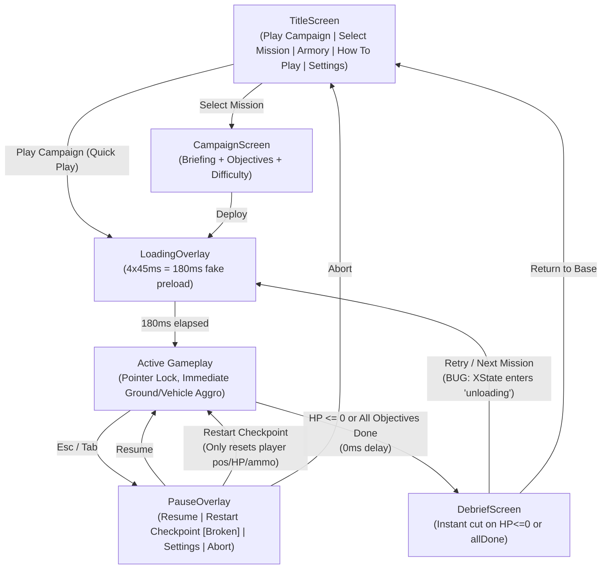
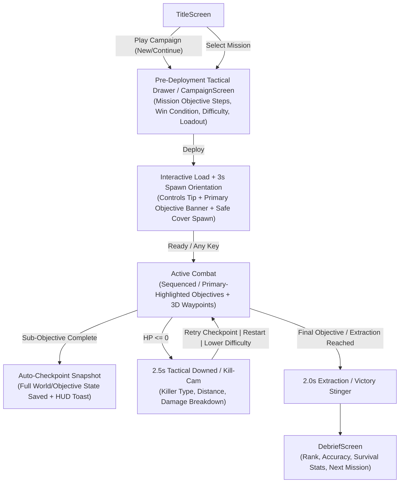

# VANGUARD: ZERO HOUR — Player Experience, Combat Balance, Mission Clarity & Architecture Audit

**Date:** 2026-11-14  
**Scope:** Investigation and architectural planning report only. No source files were modified. All findings below are grounded in inspected source files, schemas, and engine/UI state definitions; unmeasured runtime values are explicitly separated under **Probable Causes** and **Section K (Questions & Unknowns)**.

---

## A. Executive Summary — Top 10 Problems

1. **Primary CTA Skips Mission Briefing & Difficulty Selection (`TitleScreen.tsx` → `App.tsx`)**: Clicking **"Play Campaign"** launches Mission 1 immediately at `normal` difficulty, bypassing `CampaignScreen.tsx`—the only screen containing `activeMission.briefing`, objective `description`s, and difficulty selection.
2. **Broken XState Replay/Next-Mission Lifecycle (`EngineLifecycle.ts` vs `GameEngine.ts`)**: Launching a mission from `debrief` sends `SELECT_MISSION`, which transitions `EngineLifecycle` into `unloading` instead of `preloading`, causing `ASSETS_LOADED` and `WORLD_READY` to be silently dropped.
3. **Zero 3D World-Space Objective Guidance (`GameHUD.tsx`, `MissionDirector.ts`)**: `ObjectiveStatusSchema` strips `description` and `markerPos` from mission configs. Players see only short titles (`0/2`) and `6px` dots inside a `112×112px` circular radar (`95m` range), with no 3D screen-projected waypoints, distance indicators, or compass markers.
4. **Immediate Open-Street Spawn Under Multi-Source Fire (`missions.ts`, `EnemyManager.ts`, `VehicleManager.ts`)**: Only `AirCombatManager` implements `initialGraceTimerSec` (`3.0–5.5s`). Ground infantry, snipers (`115m` detection), rocket troopers (`85m` detection), and hostile technicals engage immediately while the player spawns exposed in the central road at `(0, 1.7, 58)` facing straight into Mission 1's main garrison.
5. **High Burst Lethality vs. Leaky Armor & Slow Regen (`PlayerController.ts`, `combat.schema.ts`, `enemies.ts`)**: Player armor (`100`) absorbs only `55%` of incoming damage (`45%` bleeds directly into `100` HP from shot #1). With `maxGlobalAttackers: 3`, `damageBurstThreshold2s: 55 HP` (~100 raw dmg), and `5.5s` delayed regen capped at `65 HP`, overlapping bursts from snipers (`22` dmg), rockets (`32` dmg), LMG (`37.5–52.5` raw/burst), and gunships kill an unoriented player in **~4–6 seconds**.
6. **Low-Contrast Micro-Scale Targets + Leg Hitbox Gaps (`EnemyManager.ts`, `WeaponSystem.ts`, `LightingRig.ts`)**: Ground soldiers (`0.52m` torso width) use dark grey/olive/black palettes inside `FogExp2` (`night`, `misty_dawn`, `storm_dusk`), projecting to ~8–13 px wide at `50–80m`. Hit detection uses only 2 spheres (`y+1.0` body, `y+1.66` head), leaving lower legs (`y < 0.44m`) completely unhittable while camera trauma shake (`Math.random()`) disrupts aim on near-misses.
7. **Broken `Restart Checkpoint` & Abrupt Zero-Feedback Defeat (`GameEngine.ts`, `MissionDirector.ts`)**: `Restart Checkpoint` only repositions the player and tops up HP/ammo—it never resets enemies, vehicles, destructibles, timer, or objective counters. Meanwhile, reaching `0 HP` cuts instantaneously to `DebriefScreen` with no kill-cam, cause-of-death summary, or checkpoint retry.
8. **Unreachable Rooftops & Non-Climbable Watchtowers (`MapBuilder.ts`, `PhysicsWorld.ts`, `WorkerBridge.ts`)**: `placeEnterableBuilding` seals everything above the `4m` ground floor as a solid AABB (`${id}_ceiling_upper`), and `placeWatchtower` creates elevated `y=8.8m` decks with zero stairs, ladders, ramps, or lifts. `PhysicsWorld` slopes only support Z-axis interpolation, and `WorkerBridge` builds a flat 2D `120×120` grid (`y=0.48..1.85m`), leaving AI completely blind to verticality.
9. **Unsequenced Objectives & Silent Extraction Failure (`MissionDirector.ts`)**: All mission objectives are active simultaneously from `t=0`. Stepping onto Mission 5's extraction pad before clearing prerequisites produces zero HUD feedback; `onDestructibleTargetDestroyed` conflates `destroy_targets` and `plant_charge`; and Mission 5 requires `12/12` initial enemies, forcing a `26–28s` wait for reinforcement spawns if a single enemy is missed.
10. **Vehicle Occupant Splash Vulnerability & Incomplete Onboarding (`ExplosiveManager.ts`, `HowToPlayModal.tsx`)**: Inside vehicles, `ExplosiveManager` still applies radial splash damage directly to the player independently of vehicle armor, `driver_fpv` turret shots originate at `y+2.45` disconnected from driver view, and `HowToPlayModal` omits C4 (`[C]`), Bomb Strike (`[V]`), TRIDENT-X (`[N]`), and `[Tab]` cursor unlock.

---

## B. Current Implementation Inventory

| Subsystem | Key Files & Symbols | Current Status | Notes / Gaps |
| :--- | :--- | :--- | :--- |
| **App Routing & Screen Flow** | `src/App.tsx` (`App`, `handleDeploy`), `src/stores/uiStore.ts` | **Implemented (Flawed Flow)** | Quick Play skips `CampaignScreen`; `HowToPlayModal` back button hardcodes `'title'`. |
| **Engine Lifecycle State Machine** | `src/engine/EngineLifecycle.ts` (`engineLifecycleMachine`), `src/engine/GameEngine.ts` (`startMission`, `completeMission`) | **Partially Broken** | `debrief -> SELECT_MISSION` enters `unloading`, dropping `ASSETS_LOADED`/`WORLD_READY` on Retry/Next Mission. |
| **Mission Config & Progression** | `src/data/missions.ts` (`MISSIONS`), `src/stores/missionSelectionStore.ts`, `src/stores/progressionStore.ts` | **Implemented** | Rich `briefing`, `markerPos`, and `description` data exist but are hidden during Quick Play and HUD gameplay. |
| **Mission & Objective Director** | `src/gameplay/MissionDirector.ts` (`MissionDirector.update`, `onEnemyKilled`, `onExtractionReached`) | **Incomplete / Buggy** | Parallel-only objectives; silent `onExtractionReached` failure; `destroy_targets`/`plant_charge` conflated; no checkpoint snapshots. |
| **Player Movement & Health/Armor** | `src/gameplay/PlayerController.ts` (`update`, `takeDamage`, `syncCamera`) | **Implemented (Punishing)** | `55%` armor absorption (`45%` bleed), `5.5s` regen delay capped at `65 HP`, no armor regen, `0.48m` step-up, aim trauma shake on near-miss. |
| **Weapons, Aiming & Hit Detection** | `src/gameplay/WeaponSystem.ts` (`fireShot`, raycast hitboxes), `src/data/weapons.ts` | **Implemented (Gaps)** | 2-sphere enemy hitboxes miss legs (`y < 0.44m`); unoutlined thin white crosshair (`GameHUD.tsx`); random hip/move spread. |
| **Ballistics & Obstruction** | `src/gameplay/BallisticSolver.ts` (`SOLID_OBSTRUCTION_MASK`) | **Implemented** | Authoritative raycast against world/building/vehicle masks; preserves physical cover integrity. |
| **Combat Coordination & Tokens** | `src/gameplay/CombatEngagementCoordinator.ts`, `src/schemas/combat.schema.ts` | **Implemented** | Enforces `maxGlobalAttackers`, token leases, `damageBurstThreshold2s`, LKP, and LOS-aware firing. |
| **Enemy AI & Visual Meshes** | `src/gameplay/EnemyManager.ts`, `src/data/enemies.ts`, `src/schemas/enemy.schema.ts` | **Implemented (Low Readability)** | Dark `0.52m`-wide meshes lost in fog; ground units lack spawn grace; high sniper/rocket/LMG burst damage. |
| **Air & Vehicle Combat** | `src/gameplay/AirCombatManager.ts`, `src/gameplay/VehicleManager.ts`, `src/gameplay/VehicleCameraRig.ts`, `src/gameplay/ExplosiveManager.ts` | **Partially Broken** | `AirCombatManager` has `3.0–5.5s` grace, vehicles do not; splash hurts player inside vehicles; `driver_fpv` muzzle offset. |
| **World Geometry & Buildings** | `src/world/MapBuilder.ts` (`placeEnterableBuilding`, `placeWatchtower`, `buildExtractionBeacon`), `src/world/LightingRig.ts` | **Incomplete Verticality** | Ground floor enterable; upper floors sealed solid; watchtower `y=8.8m` unreachable; `registerBvhMesh` only registers `children[0]`. |
| **Physics & Terrain Slopes** | `src/engine/physics/PhysicsWorld.ts` (`addSlope`), `src/engine/physics/CollisionResponseSystem.ts` | **Limited Verticality** | Supports elevated `box.maxY` floors and `0.48m` steps, but `TerrainSlopeRegion` only interpolates along Z-axis. |
| **AI Navigation & Worker** | `src/workers/WorkerBridge.ts` (`uploadCollisionGrid`), `src/workers/navigation.worker.ts` | **Flat 2D Only** | Single `120×120` grid (`cellSize: 2m`) sampling `y=0.48..1.85m`; zero rooftop nodes or vertical off-mesh links. |
| **HUD, Minimap & Modals** | `src/ui/hud/GameHUD.tsx`, `src/ui/screens/Overlays.tsx`, `src/ui/screens/HowToPlayModal.tsx` | **Minimal / Missing Cues** | No 3D waypoints, distance, directional threat arrows, or target HP hover; unlabelled `6px` radar dots; instant debrief. |
| **Telemetry & F4 Diagnostics** | `src/gameplay/CombatTelemetryRecorder.ts`, `src/ui/debug/CombatDebugOverlay.tsx`, `src/gameplay/diagnostics/*` | **Implemented (Metric Gaps)** | 13 debug tabs exist; missing TTK/survival time buckets, cause-of-death snapshot, player accuracy, crate usage. |

---

## C. Actual Game Flow & State Transitions

### C.1 Current UI & Engine Lifecycle Flow (As Implemented)

### C.2 Current XState (`EngineLifecycle.ts`) & Mission Loop Transitions

| From State | Event / Trigger | Target State | Code Location | Actual Behavior & Defects |
| :--- | :--- | :--- | :--- | :--- |
| `idle` | `SELECT_MISSION` | `preloading` | `EngineLifecycle.ts` | Normal first-boot path from Title/Campaign. |
| `preloading` | `ASSETS_LOADED` | `constructing` | `GameEngine.ts:391-410` | Runs 4× `45ms` synthetic steps; unreadable by user. |
| `constructing` | `WORLD_READY` | `playing` | `GameEngine.ts:476-483` | Immediately requests pointer lock and ticks AI. |
| `playing` | `PAUSE` (`Esc`) | `paused` | `GameEngine.ts` | Opens `PauseOverlay`. |
| `paused` | `RESTART_CHECKPOINT` | `playing` | `GameEngine.ts:530-544` | **BROKEN**: Keeps dead/moved enemies, wrecked vehicles, elapsed timer, and partial objectives. |
| `playing` | `playerHealth <= 0` | `debrief` | `MissionDirector.ts:134-143` | **ABRUPT**: Instant `0ms` transition; no death-cam, no "what killed you", no retry-checkpoint. |
| `playing` | `allDone === true` | `debrief` | `MissionDirector.ts:134-143` | **ABRUPT**: Instant victory cut before explosion/extraction settle. |
| `debrief` | `SELECT_MISSION` (Retry / Next) | `unloading` *(intended: `preloading`)* | `EngineLifecycle.ts:99-108` vs `GameEngine.ts:380` | **CONFIRMED BUG**: XState transitions `debrief -> unloading` on `SELECT_MISSION`, ignoring subsequent `ASSETS_LOADED`/`WORLD_READY` events. |

### C.3 Proposed Improved Player Journey

### C.4 Explicit Answers to the 18 Core Game Flow Questions

1. **Where does a first-time player enter?** `TitleScreen.tsx`, where the prominent **"Play Campaign"** CTA bypasses briefing straight into Mission 1 (`missionSelectionStore` defaults: `missionId=1`, `difficulty='normal'`).
2. **Does the player see the mission briefing before combat?** **No**, unless they click *"Select Mission"* instead of *"Play Campaign"*.
3. **How long is the loading/transition window?** `180ms` (`4 × 45ms` synthetic steps in `GameEngine.ts:391-408`), far too brief to read any tip or orient.
4. **How is the player oriented on spawn?** Only a `4.2s` `alertText` banner (`MissionDirector.ts:54`). Player spawns in the open street `(0, 1.7, 58)` facing North toward active enemy patrols.
5. **Is there an interactive tutorial or onboarding mission?** **No.** Only a static modal (`HowToPlayModal.tsx`) accessible from the Title screen, missing C4/Airstrike/TRIDENT-X/cursor controls.
6. **How are objectives structured?** **Flat parallel list.** Every objective (`eliminate_wave`, `destroy_targets`, `down_aircraft`, `plant_charge`, `reach_extraction`) starts active at `t=0`.
7. **How does the player know *where* to go for each objective?** Only via tiny `6px` yellow dots clamped to a `112px` circular minimap (`95m` range). There are **no** 3D world waypoints, distance readouts, or compass icons.
8. **How does the player know *how* to interact with objectives (C4, relays, caches, extraction)?** Not clearly communicated; `plant_charge` and `destroy_targets` share identical destruction logic (`MissionDirector.ts:82-86`), and Mission 5's extraction beacon gives no prompt if prerequisites remain incomplete.
9. **Are there mid-mission checkpoints?** **No real checkpoints.** `Restart Checkpoint` only moves the player back to spawn with restored vitals/ammo while leaving the battlefield mutated.
10. **What happens when the player enters a vehicle or uses support strikes?** Vehicle HUD replaces weapon HUD; driver camera (`driver_fpv`) fires turret from `y+2.45`, and player remains vulnerable to radial splash damage. Support strikes require score thresholds (`150` / `1500` REQ) not explained in `HowToPlayModal`.
11. **What triggers mission failure?** Only `playerHealth <= 0` (`MissionDirector.ts:134-143`). There is no mission timer failure or VIP failure.
12. **What happens at the instant of death?** Immediate `0ms` cut to `DebriefScreen`—no kill-cam, no directional fatal-hit explanation, and no checkpoint retry.
13. **Can a struggling player recover mid-session?** Only via 3 unmarked supply crates (`[-6,46], [12,2], [-12,-30]`) or pausing to manually abort and re-enter via `Select Mission` to lower difficulty.
14. **What triggers mission victory?** `objectives.every(o => o.completed)`. On Mission 5, stepping on the extraction pad completes `reach_extraction` *only* if all prior objectives are already done.
15. **What happens if the player reaches extraction early?** `onExtractionReached()` returns silently with zero HUD explanation of missing prerequisites.
16. **What happens if a wave enemy is left alive or stuck?** In Mission 5 (`12` required from `12` initial spawns), the player stalls until `enemies < 4` triggers the `26–28s` reinforcement loop (`GameEngine.ts:958-960`).
17. **What happens on Retry or Next Mission from Debrief?** `GameEngine.startMission` sends `SELECT_MISSION` from `debrief`, hitting an XState lifecycle mismatch (`unloading` instead of `preloading`).
18. **How does progression persist between missions?** Via `progressionStore.ts` (score, rank, unlocked missions), triggered on victory in `completeMission`.

---

## D. Root-Cause Analysis

### Confirmed Bugs (Verified Directly in Source Code)

| # | Problem & Severity | Evidence & File/Function | Root Cause | Player Impact | Recommended Solution |
| :- | :--- | :--- | :--- | :--- | :--- |
| **B1** | **Replay/Next-Mission State Machine Desync** *(High)* | `EngineLifecycle.ts:99-108` vs `GameEngine.ts:380, 410, 476` | From `debrief`, `SELECT_MISSION` transitions XState to `unloading` instead of `preloading`, causing `ASSETS_LOADED` and `WORLD_READY` to be ignored. | Lifecycle state stops tracking active gameplay after Retry / Next Mission. | Transition `debrief -> SELECT_MISSION -> unloading` cleanly to `preloading` on `UNLOAD_COMPLETE`, or dispatch `RETRY_MISSION` before `startMission`. |
| **B2** | **Broken `Restart Checkpoint`** *(Critical)* | `GameEngine.ts:530-544`, `MissionDirector.ts:127-130, 148-150` | Checkpoint handler only resets `player.position`, `health`, `armor`, and ammo; world entities, objectives, and timer remain dirty. | Restarting puts player in a half-cleared or overrun map with broken wave counts. | Implement serialized `CheckpointSnapshot` (player state, objective progress, remaining wave spawns, destructibles, vehicles, timer). |
| **B3** | **Silent Extraction Failure & Conflated Objective Types** *(High)* | `MissionDirector.ts:82-86, 93-100`, `GameEngine.ts:949-955` | `onExtractionReached` exits silently if `!allPreDone`; `onDestructibleTargetDestroyed` advances both `destroy_targets` and `plant_charge`. | Players stand on Mission 5 extraction pad wondering why nothing happens. | Emit explicit HUD alert listing remaining incomplete objectives; decouple `plant_charge` from generic destructibles. |
| **B4** | **Unreachable Watchtowers & Sealed Building Roofs** *(Critical)* | `MapBuilder.ts:158-417` (`placeEnterableBuilding`, `placeWatchtower`) | Watchtower platform sits at `y=8.8..9.25m` with no climbable geometry; building floors above `y=4.0m` are sealed inside `${id}_ceiling_upper`. | Players cannot reach rooftops or watchtower decks; sniper briefing lore contradicts level geometry. | Add standardized vertical traversal primitives (ramps/stairs or lift pads) + open rooftop parapets/access hatches. |
| **B5** | **BVH Registration Only Indexes First Child Mesh** *(Medium)* | `MapBuilder.ts:196` | `registerBvhMesh(grp.children[0] as THREE.Mesh)` only registers the building ground slab, ignoring walls, pillars, and upper structure. | BVH-accelerated queries miss walls/upper floors (though Rapier/AABB covers collisions). | Traverse `grp.traverse(...)` and register every `THREE.Mesh` child with world transforms. |
| **B6** | **Leg Hitbox Blind Spot** *(High)* | `WeaponSystem.ts:487-507`, `EnemyManager.ts` | Hitboxes test only 2 spheres (`y+1.0` r=`0.56`/`0.72` and `y+1.66` r=`0.30`); `y = 0.0..0.44m` has zero collision volume. | Shots at enemy legs/lower torso pass straight through with zero hit feedback. | Replace 2-sphere check with a 3-zone capsule/multi-sphere stack (lower-body/legs, chest/torso, head) matching visual mesh bounds. |
| **B7** | **Vehicle Occupants Take Direct Radial Splash Damage** *(High)* | `ExplosiveManager.ts:894-929`, `VehicleManager.ts:540` | `resolveExplosion` applies distance-based splash directly to `player` even when `inVehicle === true`; `driver_fpv` turret fires from `y+2.45`. | Rockets/explosions injure/kill players inside armored vehicles unexpectedly. | Route explosion damage to vehicle hull first when `inVehicle === true`, applying only scaled shock bleed if hull survives or ejecting on hull breach. |

### Probable Causes (Derived from Architecture & Tuning Inspection; Needs Runtime Telemetry Confirmation)

| # | Problem & Severity | Evidence & File/Function | Probable Cause | Player Impact | Recommended Solution |
| :- | :--- | :--- | :--- | :--- | :--- |
| **P1** | **New Players Die Within Seconds ("Dying Before Doing Anything")** *(Critical)* | `missions.ts:15,45-58`, `combat.schema.ts:114-128`, `PlayerController.ts:38-42,218-227` | Exposed spawn `(0,1.7,58)`, zero ground/vehicle grace (`EnemyManager`/`VehicleManager`), `45%` armor bleed, and `3` concurrent attackers dealing `22–52` raw damage bursts. | Player takes lethal HP loss while still scanning the street for threats. | Add `4.0–5.0s` ground/vehicle spawn grace (or protected entry cover), raise armor absorption to `75–85%`, and tune Normal burst cap. |
| **P2** | **High Target Acquisition Friction at 50–100m** *(Critical)* | `EnemyManager.ts:1359-1420`, `LightingRig.ts:34-94`, `GameHUD.tsx:112-145` | `0.52m` dark meshes blend into fog (`night`/`misty_dawn`/`storm_dusk`); unoutlined white crosshair washes out; camera near-miss trauma shake (`PlayerController.ts:515-516`) jerks aim. | Player cannot spot shooters before getting burst down, driving "make targets bigger" feedback. | Add tactical rim/visor/silhouette contrast, high-contrast outlined reticle, off-screen threat indicators, and reduce near-miss camera trauma. |
| **P3** | **Mission 5 Wave Soft-Stall Delay** *(Medium)* | `missions.ts:280-285`, `GameEngine.ts:958-960` | `eliminate_wave` requires `12` kills out of `12` initial enemies; missing 1 straggler forces `26–28s` wait for reinforcement spawns. | Slows pacing and confuses players who cleared the visible courtyard. | Set initial wave target to `<= 80%` of spawned wave (`10/12`) or mark last 2 remaining enemies on HUD. |

### Design Recommendations (Structural UX & Feature Gaps)

1. **Mandatory Pre-Combat Mission Summary (`TitleScreen.tsx` → `CampaignScreen.tsx`)**: Route "Play Campaign" through a concise 1-click Briefing/Loadout drawer (or show an interactive pre-deploy tactical overlay) showing win condition, difficulty, and primary controls.
2. **Projected 3D World Waypoints & Objective Sequencing (`MissionDirector.ts` + `GameHUD.tsx`)**: Expose `markerPos` and `description` via `ObjectiveStatusSchema`; project screen-space diamond markers with meter distance (`[42m]`), interact prompts, and sequential/primary objective highlighting.
3. **Downed/Kill-Cam Recovery Loop (`MissionDirector.ts` + `Overlays.tsx`)**: Add a `2.5s` downed state showing fatal attacker, distance, and damage split, plus a **Retry Last Checkpoint** action alongside Restart Mission.
4. **Complete `HowToPlayModal.tsx` & Pause Accessibility**: Document `[C]` C4, `[V]`/`[Shift+V]` Bomb Strike, `[N]` TRIDENT-X, and `[Tab]` cursor mode, and allow opening Controls directly from `PauseOverlay`.

---

## E. Combat Balance & Survivability Assessment

### E.1 Exact Player Survivability & TTK Math (Inspected Values)

- **Effective Health Pool (`PlayerController.ts:38-42, 218-227`)**:
  - Starting vitals: `100 HP + 100 Armor`.
  - Damage split: `armorAbsorb = Math.min(armor, amount * 0.55)`, `hpDamage = amount - armorAbsorb`.
  - **45% of every bullet bleeds directly into HP from shot #1.** Absorbing `181.8` raw damage depletes all `100` armor while already dealing `81.8 HP` damage, leaving `18.2 HP` (**~200 raw damage Total EHP**).
  - Regen (`lines 331-334`): Requires **`5.5s` without ANY damage**, heals at **`8 HP/s`**, and **caps at `65 HP`**. Armor has zero passive regen; only 3 unmarked supply crates (`MapBuilder.ts:732-736`) restore `+55 HP / +65 Armor`.
- **Incoming Enemy DPS (`combat.schema.ts:114-128`, `enemies.ts`, `AirCombatManager.ts`)**:
  - On `normal`, `maxGlobalAttackers = 3`, `reactionDelayBaseSec = 0.5s`, `damageBurstThreshold2s = 55 HP` (which equals `~100–122` raw damage before throttling for just `1.0s`).
  - Individual enemy burst outputs:
    - `enemy_sniper` (`detectionRange: 115m`, `attackRange: 105m`, `baseSpreadRad: 0.012` = `0.69°`): **`22.0` raw dmg/shot** (`29.7` headshot = `13.4` direct HP bleed even with full armor).
    - `enemy_rocket` (`detectionRange: 85m`): **`32.0` raw dmg** + blast splash.
    - `enemy_lmg`: `5–7` rounds @ `0.11s` × `7.5 dmg` = **`37.5–52.5` raw dmg per `0.66s` burst**.
    - `enemy_autocannon` (Heli/Technical): `4–5` rounds @ `0.13s` × `6.5 dmg` = **`26.0–32.5` raw dmg per burst**.
    - `enemy_assault_rifle`: `3–4` rounds × `6.5 dmg` = **`19.5–26.0` raw dmg per burst**.
  - **Time-to-Die (TTD) in Mission 1 Opening**: Spawning at `(0, 1.7, 58)` places 5 infantry (`~45m` away, within `65m` detection and `58m` gunshot hearing), 2 snipers (`115m`), 2 rocket troopers (`85m`), and 1 technical (`(16, 0, -12)`) in range. With `3` active attackers firing simultaneously (`1` LMG/rifle + `1` sniper + `1` rocket/technical), an unoriented player absorbs **`90–130` raw damage per `2s` window**, hitting `damageBurstThreshold2s` repeatedly and dying in **`4.0–6.0 seconds`**.
- **Player vs. Enemy Time-to-Kill (TTK) Asymmetry (`weapons.ts` vs `enemies.ts`)**:
  - `assault_rifle` (`28` body / `58.8` head): `infantry` (`100 EHP`) takes **4 body shots**, `elite_assault` (`165 EHP`) **6 shots**, `heavy_armor` (`300 EHP`) **11 shots**. Combined with small low-contrast silhouettes (`0.52m` wide), missing legs (`y < 0.44m`), and near-miss camera shake, new players spend `1.5–3s` acquiring each target while losing `30–50%` HP.

### E.2 Missing Telemetry Metrics in `CombatTelemetryRecorder.ts`

To validate balance changes empirically in `[F4]`, add:
1. **Player Survival Buckets & TTD**: Time from spawn to death (`0–15s`, `15–30s`, `30–60s`, `>60s`) and time-to-first-damage-taken.
2. **Cause-of-Death Snapshot**: Last 5 damage events (`attackerId`, `archetype`, `weapon`, `distance`, `rawDmg`, `hpLost`, `armorLost`, `wasInVehicle`).
3. **Player Gunplay Efficiency**: Shots fired, shots hit, headshot ratio, leg-miss rate, and time-to-first-kill per weapon.
4. **Recovery & Resource Usage**: Supply crates looted, health regenerated, time spent below `35% HP`, and objective completion timestamps.

### E.3 Proposed Difficulty Tuning Matrix (Preserving Core AI Architecture)

All presets **preserve** token-capped squads, `CombatEngagementCoordinator`, physical cover/ballistics (`BallisticSolver`), LKP, and LOS-aware firing—adjusting **player survivability, reaction pacing, and telegraphing** rather than breaking AI intelligence:

| Parameter | Current `Normal` | Proposed `Easy` (Story/Rookie) | Proposed `Normal` (Balanced) | Proposed `Hard` | Proposed `Extreme` |
| :--- | :--- | :--- | :--- | :--- | :--- |
| **Player HP / Armor** | `100 / 100` | `150 / 150` | `125 / 125` | `100 / 100` | `100 / 75` |
| **Armor Absorption** | `55%` (`45%` bleed) | `85%` (`15%` bleed) | `78%` (`22%` bleed) | `68%` (`32%` bleed) | `55%` (`45%` bleed) |
| **HP Regen Delay / Rate / Cap** | `5.5s` / `8/s` / `65` | `3.2s` / `14/s` / `100` | `4.0s` / `11/s` / `85` | `5.0s` / `8/s` / `65` | `6.5s` / `6/s` / `50` |
| **Ground/Vehicle Spawn Grace** | `0s` *(Air only: 3–5.5s)* | `6.0s` (all units) | `4.5s` (all units) | `2.5s` (all units) | `1.5s` (all units) |
| **`maxGlobalAttackers`** | `3` | `2` | `2` *(3 on boss/climax)* | `3` | `4` |
| **`reactionDelayBaseSec`** | `0.50s` | `0.95s` | `0.75s` | `0.50s` | `0.35s` |
| **`damageBurstThreshold2s` / Throttle** | `55 HP` / `1.0s` | `35 HP` / `2.0s` | `45 HP` / `1.6s` | `55 HP` / `1.0s` | `75 HP` / `0.7s` |
| **Sniper / Rocket First-Shot Warning** | Instant fire | `1.4s` laser/audio cue | `1.0s` laser/audio cue | `0.65s` cue | `0.4s` cue |
| **Enemy Spread Multiplier** | `1.0×` | `1.45×` | `1.20×` | `1.0×` | `0.85×` |

---

## F. Mission & UX Assessment + Target Visibility, Size & Readability

### F.1 Why Players Ask *"How to Win?"* & *"Make Targets Bigger"*

1. **(A) Visual Presentation & Silhouette/Lighting Contrast**:
   - In `EnemyManager.ts:1359-1420`, infantry meshes (`torso 0.52×0.64×0.32m`, `head 0.28×0.30×0.28m`) use muted dark colors (`#5c6654`, `#374151`, `#1f2937`, `#1c1917`, `#4b5563`).
   - Against grey concrete buildings and `FogExp2` (`fogDensity: 0.0042..0.0075` in `LightingRig.ts`), soldiers lose figure-ground separation—especially in `night` (M3), `misty_dawn` (M4), and `storm_dusk` (M5). Only a tiny `0.24×0.08m` visor strip emits light.
   - **Fix**: Do **not** distort soldiers into cartoonish giants; instead apply **1.08–1.15× heroic tactical proportions** (broader shoulders/helmets ~`0.62m` torso, `0.34m` helmet), add subtle **Fresnel rim-lighting / faction shoulder & chest IFF strobes**, brighten muzzle flashes & tracer trails, and add sniper laser sight beams prior to firing.
2. **(B) Aiming, Crosshair & World-Space Markers**:
   - `GameHUD.tsx:112-145`: The white `2px` crosshair lacks a dark outline/shadow, disappearing against bright sky/sand (`daylight`, `sunset`).
   - `GameHUD.tsx:215-267`: The `112px` circular radar (`95m` range) shows `6px` unlabelled dots with zero elevation or facing cones.
   - **Fix**: Add `1px` dark drop-shadow/outline to all reticle lines + dynamic spread/hit/headshot/kill confirmation ticks; add **screen-space 3D objective diamonds with `[XXm]` distance**, **top compass bar objective/enemy pips**, **off-screen directional threat chevrons** (pre-hit sniper/rocket warning + post-hit direction), and **target nameplate/HP bar** when reticle lingers on a visible enemy within range.
3. **(C) Hitbox vs. Mesh Alignment**:
   - `WeaponSystem.ts:487-507` checks only 2 spheres (`y+1.0` body, `y+1.66` head), leaving **`y = 0.0..0.44m` (lower legs) completely non-hittable** and creating gaps around shoulders.
   - **Fix**: Upgrade to a **3-zone articulated hit volume** (capsule/capsule-approximated spheres: Lower/Legs `y=0.0..0.75`, Torso/Shoulders `y=0.75..1.45`, Head/Helmet `y=1.45..1.88`) aligned cleanly to the rendered mesh, plus mild bullet magnetism (`~0.04m` forgiving capsule padding on Easy/Normal only, disabled on Hard/Extreme).
4. **(D) Acquisition Difficulty at Combat Distance**:
   - At `60–80m` (`78°` FOV, 1080p), a `0.52m × 1.70m` soldier occupies only **`~8–11 px` width**, while `PlayerController.syncCamera` (`lines 515-516`) injects random trauma shake even from near-misses (`+0.12` per near-miss).
   - **Fix**: Halve near-miss trauma (use directional audio + subtle vignette flash instead of jolting the player's aim), and ensure early-mission encounters start at `25–45m` before introducing `80–110m` sniper sightlines.

---

## G. Building & Vertical Traversal Assessment

### G.1 Current Structural Constraints

- **`MapBuilder.ts`**:
  - `placeEnterableBuilding`: `groundH = 4.0m` hollow interior, then `${id}_ceiling_upper` forms a solid impenetrable box from `y + 3.85m` to `y + h` (`16–28m`).
  - `placeWatchtower`: Deck at `y = 8.8..9.25m` with 4 legs and zero stairs, ladders, or lifts.
- **`PhysicsWorld.ts` (`lines 31-40, 185-200`) & `CollisionResponseSystem.ts` (`lines 157-190, 252-275`)**:
  - Standing on elevated AABB surfaces (`box.maxY`) and stepping up `<= 0.48m` already works.
  - `TerrainSlopeRegion` **only interpolates height along the Z-axis** (`(z - s.startZ)/(s.endZ - s.startZ)`), preventing X-oriented or rotated staircases/ramps without extending slope math.
- **`WorkerBridge.ts` (`lines 59-95`) & `navigation.worker.ts`**:
  - Builds a **flat single-layer 2D `120×120` grid** (`cellSize: 2m`) sampling `0.48m..1.85m`. AI has no multi-floor cells or vertical links.

### G.2 Traversal Option Comparison

| Criterion | Option A: Tactical Lift / Jump-Pad Platform | Option B: Physical Stairs, Ramps & Ladders | Option C: Hybrid (Stairs/Ramps on Watchtowers & Low Roofs + Tactical Lift for Tall Buildings) |
| :--- | :--- | :--- | :--- |
| **Physics Complexity** | **Low** — Cylindrical/box trigger zone + smooth vertical kinematic curve (`y(t)` easing) into rooftop floor AABB. | **Medium-High** — Requires rotated/directional `SlopeRegion` support (X & Z), downward ramp-snapping, and dedicated ladder-climb state in `PlayerController`. | **Medium** — Stairs/ramps for `4–9m` watchtowers & 2-story roofs; Lift pads for `16–28m` skyscrapers. |
| **AI Navigation (`WorkerBridge`)** | **Simple** — Add explicit off-mesh vertical jump/teleporter portal links or designate lift-locked player vantage points. | **Complex** — Requires multi-layer height grid or off-mesh stair/ramp waypoints so AI doesn't get stuck under stairs. | **Manageable** — Standard ramp/stair off-mesh links on watchtowers + rooftop sniper/drone patrols on tall roofs. |
| **Visual Clarity & Affordance** | **Very High** — Glowing cyan/amber pad with hologram arrows & `[F] Ascend / Step On` prompt; impossible to miss. | **High (Familiar)** — Visually intuitive if exterior staircases have bright safety rails/lighting, though narrow ladders feel clunky in fast FPS. | **Highest** — Low structures look naturally climbable; tall towers have unmistakable glowing roof-access lifts. |
| **Combat / Tactical Flow** | Fast vertical repositioning; risks feeling slightly sci-fi unless styled as a military cargo/scissor hoist. | Authentic tactical feel, peekable angles mid-climb, natural cover on landings; ladders leave player defenseless. | Best of both: authentic firefights up watchtower stairs/ramps + rapid roof access on multi-story towers. |
| **Risk of Player Getting Stuck** | **Low** (deterministic arrival pad check + roof parapet collider). | **Medium** (stair railing snagging, ramp bounce on descent without slope-snap fix). | **Low-Medium** (if ramps use wide `2.4m` smooth proxy slopes + parapet rails). |

### G.3 Recommended Architectural Choice: **Option C (Hybrid — Wide Smooth Ramps/Stairs for Watchtowers + Rooftop Tactical Cargo Lifts for High-Rises)**

1. **Watchtowers (`y = 8.8m`) & 1-Story Cover Roofs (`y = 4.0m`)**: Add **exterior switchback/zig-zag wide steel ramps/stairs (`2.4m` wide)** using a generalized `OrientedSlopeRegion` (supporting arbitrary `dirX, dirZ` basis vectors + downward ground-snap in `CollisionResponseSystem`) visually dressed with step meshes and safety railings.
2. **Multi-Story Buildings (`y = 16–28m`)**: Hollow out a **playable rooftop terrace with waist-high tactical parapets (`1.15m` cover walls)** instead of a flat unreachable cap, and place a clearly marked **Tactical Cargo Lift Pad** inside/beside the ground-floor doorway with a glowing vertical shaft beacon (`[Step On]` or `[E] Ride to Roof` + `[E] Descend` / rappelling drop pad).
3. **AI Verticality**: Add `NavOffMeshLink` pairs `(bottomNode <-> topNode)` to `WorkerBridge`/`navigation.worker.ts` for ramps/stairs so ground flankers can climb watchtowers, while placing dedicated rooftop snipers and aerial drones to contest tall rooftops.

---

## H. Architecture & Low-Level Design Proposal

Keep strict TypeScript, Zod validation (`src/schemas/`), Rapier3D + custom character controller (`PhysicsWorld`), and single-authority collision resolution:

| Module | Owner File(s) | Core Responsibilities & Clean Contracts |
| :--- | :--- | :--- |
| **`MissionFlowCoordinator`** | `src/engine/EngineLifecycle.ts`, `src/engine/GameEngine.ts`, `src/gameplay/MissionFlowCoordinator.ts` *(new)* | Owns clean lifecycle transitions (`preloading -> briefing -> spawning -> active -> downed -> debrief -> unloading`), eliminating the `debrief -> SELECT_MISSION -> unloading` desync. Manages pre-deploy briefing state and `2.5s` downed kill-cam before `DebriefScreen`. |
| **`ObjectiveSystem`** | `src/gameplay/MissionDirector.ts`, `src/schemas/mission.schema.ts`, `src/schemas/events.schema.ts` | Supports sequenced stages (`activeStageIndex` + optional bonus), explicit `markerPos` + `description` + `interactionType` projected to HUD, separate `plant_charge` vs `destroy_targets` handlers, and explicit failure reasons on premature extraction. |
| **`CheckpointService`** | `src/gameplay/CheckpointService.ts` *(new)* | Captures atomic `CheckpointSnapshot` on stage completion (player transform/vitals/ammo, active objective counts, remaining enemy roster/waves, vehicle states, destructibles, elapsed time) so `Restart Checkpoint` restores the true world state. |
| **`PlayerController` & `DamageSystem`** | `src/gameplay/PlayerController.ts`, `src/gameplay/DamageSystem.ts` *(new)* | Routes all damage (bullets, melee, explosion splash, vehicle bleed) through one `DamageSystem.applyPlayerDamage(source)` contract enforcing spawn grace, armor absorption (`78%` Normal), lethal-hit attribution log, and vehicle hull protection. |
| **`CombatEngagementCoordinator`** | `src/gameplay/CombatEngagementCoordinator.ts`, `src/schemas/combat.schema.ts` | Retains token caps, LKP, cover, and LOS firing; adds `globalSpawnGraceSec`, difficulty-parameterized `reactionDelayBaseSec` / `damageBurstThreshold2s`, and pre-shot sniper/rocket telegraph token phase. |
| **`EnemyManager` & Hit Volumes** | `src/gameplay/EnemyManager.ts`, `src/gameplay/WeaponSystem.ts` | Replaces 2-sphere checks with a 3-zone articulated hit volume (`legs`, `torso`, `head`) synced to mesh; adds Fresnel/visor rim contrast and laser sight telegraphing for snipers. |
| **`NavigationSystem`** | `src/workers/WorkerBridge.ts`, `src/workers/navigation.worker.ts` | Extends flat `120×120` grid with `NavLayer` / `NavOffMeshLink` entries for watchtower ramps and rooftop entry nodes, preventing AI from running beneath unreachable targets. |
| **`BuildingInteractionSystem`** | `src/world/MapBuilder.ts`, `src/engine/physics/PhysicsWorld.ts`, `src/gameplay/LiftController.ts` *(new)* | Replaces Z-only `TerrainSlopeRegion` with `OrientedSlopeRegion`; builds watchtower ramps, rooftop parapets, full-hierarchy BVH registration, and deterministic `LiftPad` ascend/descend transitions. |
| **`HUD` & World Projections** | `src/ui/hud/GameHUD.tsx`, `src/ui/screens/Overlays.tsx` | Projects `ObjectiveMarker3D` to screen coordinates (with edge clamping), adds compass pips, outlined dynamic reticle, off-screen threat chevrons, hover target HP bar, and downed kill-cam breakdown. |
| **`F4 Telemetry`** | `src/gameplay/CombatTelemetryRecorder.ts`, `src/ui/debug/CombatDebugOverlay.tsx` | Records survival duration buckets, fatal-damage breakdown, per-weapon player accuracy, leg-vs-torso hit ratio, and crate/regen totals. |

---

## I. Prioritized Improvement Roadmap

### Phase 1 — Critical Blockers (Fix Broken Loops & Immediate Frustration)
1. Fix `EngineLifecycle.ts` `debrief -> SELECT_MISSION` state bug so Retry/Next Mission reliably resets engine state.
2. Implement true `CheckpointSnapshot` restore for `Restart Checkpoint` + add `2.5s` Downed/Kill-Cam with Retry Checkpoint option.
3. Route **"Play Campaign"** through a concise Mission Briefing & Difficulty confirmation step (`CampaignScreen` or Pre-Deploy Briefing Drawer).
4. Add `4.5s` (Normal) ground/vehicle spawn grace + reposition Mission 1 spawn slightly behind starter concrete barriers (`z = 66` facing cover) instead of exposed center road.
5. Fix vehicle occupant radial splash bug in `ExplosiveManager.ts` and align `driver_fpv` firing ray.

### Phase 2 — Core Gameplay & Balance (Make Combat Fair & Crisp)
6. Tune `Normal` survivability (`125/125` HP/Armor, `78%` absorption, `4.0s` regen to `85 HP`, `maxGlobalAttackers: 2`, sniper/rocket telegraph cues).
7. Upgrade enemy hitboxes in `WeaponSystem.ts` / `EnemyManager.ts` from 2 spheres to 3-zone articulated volumes (covering legs + shoulders); halve near-miss camera trauma.
8. Instrument `CombatTelemetryRecorder.ts` with survival buckets, cause-of-death log, and player accuracy.

### Phase 3 — UX, Target Readability & Mission Clarity
9. Add `markerPos` + `description` to `ObjectiveStatusSchema` and render 3D screen-projected waypoints + `[XXm]` distance + compass bar pips + explicit premature-extraction alert.
10. Improve enemy visual silhouette readability (rim highlight, brighter IFF strobes, fog-aware emissive accents) + high-contrast outlined reticle + hit/kill ticks + pre-hit directional threat chevrons.
11. Decouple `plant_charge` vs `destroy_targets` in `MissionDirector.ts`; adjust Mission 5 wave target (`10/12` instead of `12/12`) to prevent `26s` straggler stalls; update `HowToPlayModal.tsx` and expose it from `PauseOverlay`.

### Phase 4 — Level Design & Vertical Traversal
12. Generalize `PhysicsWorld` slopes to `OrientedSlopeRegion` + downward slope-snap in `CollisionResponseSystem`.
13. Add wide exterior switchback ramps/stairs to all `placeWatchtower` structures and fix `MapBuilder.ts` BVH child traversal (`grp.traverse`).
14. Open playable rooftop terraces with parapets on key buildings and install clearly lit **Tactical Cargo Lift Pads** (`[Step On / E]`) + `NavOffMeshLink` support in `WorkerBridge`/`navigation.worker.ts`.

### Phase 5 — Advanced Features & Polish
15. Add sequential objective stages (clear outer garrison → plant charges → down gunship → extract) with mid-mission checkpoint saves at each stage transition.
16. Add dynamic adaptive hint prompts (e.g., if player takes heavy fire in open for >3s, subtle `"Seek hard cover — health regenerates after 4s"` tip once per session).

**Dependency Order:** `Phase 1 (Lifecycle + Checkpoints + Spawn/Vehicle Fix)` → `Phase 2 (DamageSystem + Hitboxes + Telemetry)` → `Phase 3 (ObjectiveSchema + 3D HUD Waypoints + Target Visibility)` → `Phase 4 (OrientedSlopeRegion + Watchtower Ramps + Rooftop Lifts + NavLinks)` → `Phase 5 (Sequenced Stages + Adaptive Hints)`.

---

## J. Automated & Manual Test Plan

### J.1 Automated Test Suite (Vitest + Playwright)

| Category | Test Scope | Concrete Assertions / Acceptance Criteria |
| :--- | :--- | :--- |
| **Lifecycle & State (`Vitest`)** | `EngineLifecycle.ts` + `MissionDirector.ts` | `debrief -> SELECT_MISSION -> unloading -> preloading -> playing` succeeds across 3 consecutive retries; `CheckpointService` restores exact enemy count, destructibles, timer, and objective state; `onExtractionReached` emits alert when prerequisites remain. |
| **Combat & Damage (`Vitest`)** | `DamageSystem` + `CombatEngagementCoordinator` + `ExplosiveManager` | `Normal` armor absorbs `78%`; ground/vehicle units deal `0` damage during `initialGraceTimerSec`; explosions outside a vehicle damage hull first without bypassing directly to occupant HP; `maxGlobalAttackers` never exceeded. |
| **Hitboxes & Ballistics (`Vitest`)** | `WeaponSystem` + `EnemyManager` + `BallisticSolver` | Raycasts at `y=0.25m` (legs), `y=1.10m` (torso), and `y=1.68m` (head) all register hits with correct zone multipliers; walls still block shots behind cover. |
| **Vertical Physics & Nav (`Vitest`)** | `PhysicsWorld` + `CollisionResponseSystem` + `WorkerBridge` | Player walks smoothly up & down `OrientedSlopeRegion` along `+X`, `-X`, `+Z`, `-Z` without bounce/snag; Lift pad moves player cleanly from `y=0` to rooftop `y=16m+` and back without clipping `ceiling_upper`; `NavOffMeshLink` routes AI onto watchtowers. |
| **Full-Session E2E (`Playwright`)** | Chromium WebGL headless/headed run | Title → Briefing/Campaign → Mission 1 deploy → kill 1 target → trigger pause → Restart Checkpoint verifies enemy count restored → die → Downed screen shows cause of death → Retry Checkpoint succeeds without console errors. |

### J.2 Human Playtest Checklist & Measurable Acceptance Criteria

- [ ] **First-Time Comprehension (Blind Test)**: New tester can state *how to win Mission 1*, locate every active objective, and explain C4/support keys **without verbal developer help** within `30s` of clicking Play.
- [ ] **Survival Curve (Normal Difficulty)**: Median first-session survival time on Mission 1 increases from `<15s` to **`>120s`**; zero deaths within first `10s` of spawn.
- [ ] **Target Acquisition**: Tester spots and lands first hit on distant (`50–80m`) infantry in `night`/`misty_dawn` maps within `3s` of taking fire, with clear reticle visibility.
- [ ] **Vertical Traversal**: Tester discovers and reaches watchtower decks and designated building rooftops **within 10 seconds** without clipping, getting stuck, or taking unintended fall damage.
- [ ] **Full Loop Integrity**: Death → Kill-Cam → Retry Checkpoint → Clear Mission → Debrief → Next Mission completes cleanly with accurate telemetry logged in `[F4]`.

---

## K. Questions and Unknowns

### Runtime Measurements Not Yet Observed (Need `[F4]` Telemetry / Playtest Run)
1. **Exact Mean Time-to-Death (TTD)** and **first-hit source distribution** (helicopter vs. sniper vs. infantry) in Mission 1 on the current build.
2. **Player Weapon Accuracy & Leg-Miss Ratio** in live combat (to quantify how much of the "make targets bigger" complaint comes from leg hitbox misses vs. silhouette size vs. near-miss trauma shake).
3. **Frame-Time Impact** of adding Fresnel/rim shaders and full building hierarchy BVH registration across all 5 missions on mid-tier GPUs.

### Material Product Decisions Requiring Your Approval Before Implementation
1. **Quick-Play vs. Briefing Flow**: When clicking **"Play Campaign"** on the Title Screen, do you want it to route to `CampaignScreen.tsx` first, or open a streamlined **Pre-Mission Tactical Briefing Overlay** (Objectives + Difficulty + Loadout + `[Deploy]`) before locking the pointer?
2. **Vertical Traversal Preference (Section G)**: Do you approve **Option C (Hybrid)**—adding wide walk-up ramps/stairs to all Watchtowers & low roofs (`4–9m`), and glowing **Tactical Cargo Lift Pads** (`Step On / E`) for tall multi-story rooftops (`16–28m`)—or do you prefer **Option A (Lift Pads everywhere)** or **Option B (Physical Stairs/Ladders everywhere)**?
3. **Difficulty Defaults**: Should **"Normal"** adopt the proposed survivability boost (`125/125` HP/Armor, `78%` absorption, `4.5s` spawn grace, `maxGlobalAttackers: 2`), or should the game launch defaulting to **"Easy / Rookie"** with current Normal preserved as **"Hard / Veteran"**?
4. **Objective Sequencing**: Should missions keep parallel objectives (highlighted by a selectable active waypoint) or enforce **staged sequential phases** (e.g., Phase 1: Breach Garrison → Phase 2: Destroy Relays → Phase 3: Down Gunship / Extract) with automatic checkpoints between stages?
